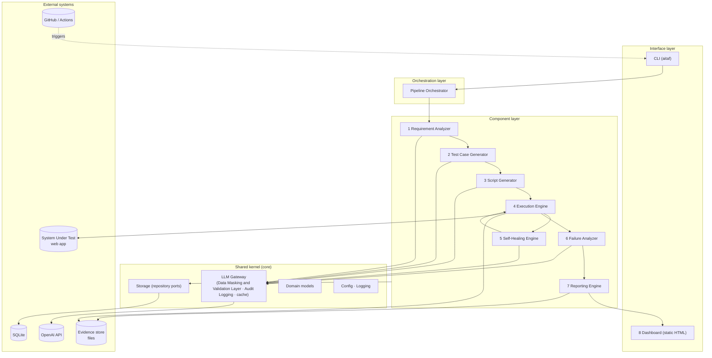
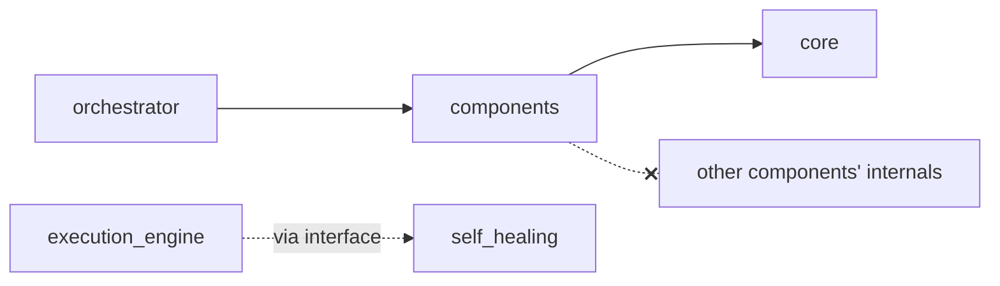
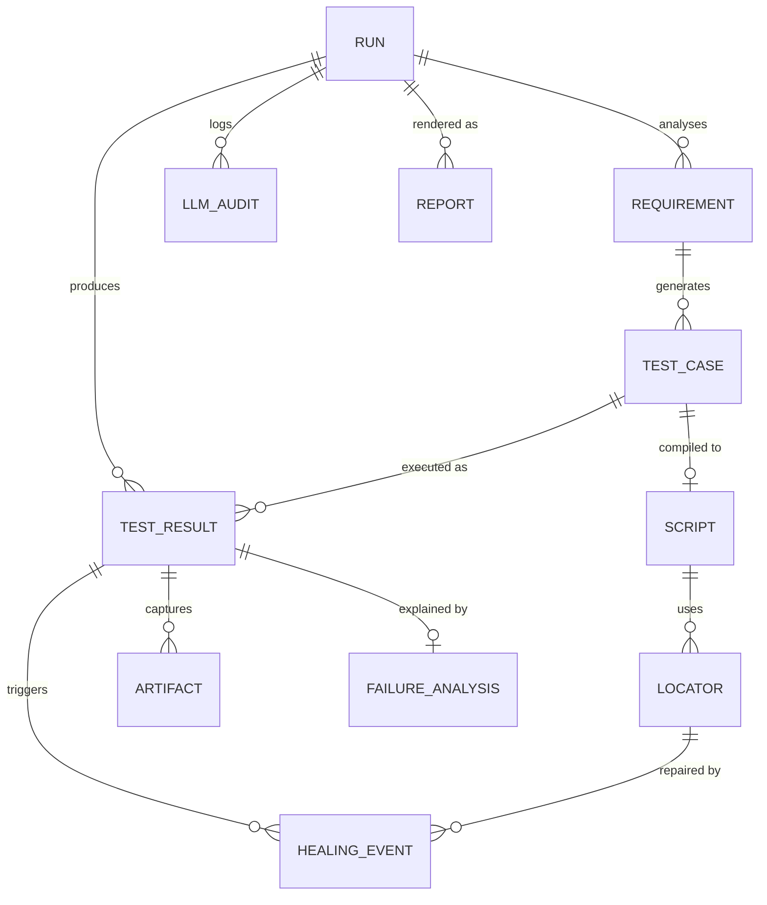

# 04 — Component Architecture

> **Note (14 Nov 2026):** the authoritative per-module specification is now `02_COMPONENT_ARCHITECTURE.md`, and the overview is `01_SYSTEM_ARCHITECTURE.md`. Use this file only for design patterns, the entity-relationship model and technology notes. If §3 here differs from `02`, `02` wins.

**Status:** Draft v0.2 · **Feeds:** Unit 3 AA (Q1a, Q1b), Report §3.1 System Architecture, §3.3 Data Flow and System Components, §3.4 Design Diagrams (official numbering, `MASTER_PLAN.md` §5)

## 1. Executive Summary

The architecture is a **pipeline of seven engines plus a Dashboard** (eight components) over a **shared kernel**, coordinated by an orchestrator. It follows the approved flow in `MASTER_CONTEXT.md` (Requirement Input → Analyzer → Test Case Generator → Script Generator → Execution Engine → Self-Healing → Failure Analyzer → Reporting → Dashboard) and uses the approved stack (Python, Playwright, Selenium, PyTest, OpenAI API, SQLite, GitHub, GitHub Actions). **No approved architecture element has been changed.**

### Rationale note on component naming (documentation required by CLAUDE.md)

The sources disagree: `CAPSTONE_MEMORY.md` lists six components with one "Test Generator"; `CLAUDE.md` lists seven; `MASTER_PLAN.md` §2 says "six approved engines plus dashboard" but then names seven engines plus Dashboard; Unit 3 DF uses other names ("AI Analysis Engine", "Test Case Generation Module").

**Resolution used here (proposed ADR-002):** adopt the **canonical list in `MASTER_PLAN.md` §2**: Requirement Analyzer, Test Case Generator, Script Generator, Execution Engine, Self-Healing Engine, Failure Analyzer, Reporting Engine, Dashboard, with cross-cutting **Data Masking and Validation Layer**, **SQLite Persistence** and **Audit Logging**. The old "Test Generator" is one approved capability delivered by two modules (natural-language artefacts vs. executable code; only the latter needs static security validation). No approved capability is added or removed; names are aligned. This needs your confirmation before it is logged in `PROJECT_DECISIONS.md`, which is currently defective (see `project-management/SOURCE_ALIGNMENT_REVIEW.md`).

## 2. Layered View

## 3. Component Specifications

(Unit 3 AA Q1b: module-wise breakdown with input, output and methodology.)

### 3.1 Requirement Analyzer
- **Responsibility:** turn raw requirements into structured, risk-rated, testable items.
- **Input:** requirement files/text (txt, md, user stories); config (risk policy).
- **Output:** `AnalyzedRequirement[]` — id, actors, actions, preconditions, expected outcomes, risk rating + rationale, ambiguity flags.
- **Methodology:** input validation/sanitisation → chunking → LLM extraction with JSON-schema–constrained output → schema validation → risk rating (LLM + rule-based keywords) → persist.
- **Depends on:** LLM Gateway, Storage. **FRs:** FR-01–05. **Key NFRs:** NFR-10, 13, 15.

### 3.2 Test Case Generator
- **Responsibility:** produce scenarios, detailed test cases and synthetic data.
- **Input:** `AnalyzedRequirement[]`.
- **Output:** `TestScenario[]`, `TestCase[]`, `TestData[]`; exports (JSON/CSV/MD); review status per case.
- **Methodology:** technique-guided prompting (equivalence partitioning, boundary-value analysis, negative paths) per requirement → schema validation → de-duplication (normalised text + similarity threshold) → synthetic data with faker-style rules → human review gate.
- **Depends on:** LLM Gateway, Storage. **FRs:** FR-06–11. **Key NFRs:** NFR-02, 15, 30, 31.

### 3.3 Script Generator
- **Responsibility:** compile approved test cases into executable PyTest scripts and a locator repository.
- **Input:** approved `TestCase[]`; target framework (Playwright | Selenium); page metadata/DOM snapshot of the SUT (optional but improves locators).
- **Output:** `.py` test files, per-page locator repository (primary + fallbacks), generation manifest.
- **Methodology:** **adapter pattern** — one `DriverAdapter` interface with Playwright and Selenium implementations; LLM proposes steps → locators → code from **templates** (LLM fills structured slots rather than writing free-form code, reducing risk) → static validation (AST allow-list, secret scan) → persist.
- **Depends on:** LLM Gateway, Storage. **FRs:** FR-12–16. **Key NFRs:** NFR-11, 17.

### 3.4 Execution Engine
- **Responsibility:** run scripts, capture evidence, expose failures to healing and analysis.
- **Input:** script set, run configuration (driver, headless, workers, retries, allow-listed base URLs).
- **Output:** `Run`, `TestResult[]`, screenshots/trace/video, logs, JUnit XML.
- **Methodology:** PyTest runner with plugin hooks (`pytest_runtest_makereport`) that capture screenshot and DOM snapshot on failure; xdist for parallelism; allow-list guard before launch; every result persisted with run ID.
- **Depends on:** Storage, evidence FS, Self-Healing (through an interface). **FRs:** FR-17–21. **Key NFRs:** NFR-04, 08, 11, 23.

### 3.5 Self-Healing Engine
- **Responsibility:** repair broken locators during execution without masking real defects.
- **Input:** failing step context — original locator record, DOM snapshot, error type, screenshot ref.
- **Output:** `HealingEvent` (strategy, old/new locator, confidence, validated?, approved?) and a healed element handle for the running step.
- **Methodology (cost-ordered ladder):**
  1. **Detect:** classify error as locator failure vs. other (FR-22).
  2. **Fallback strategies** stored with the locator (id → CSS → text/role → XPath).
  3. **DOM-similarity matching:** score candidates on tag, attributes, text, position in tree, neighbours.
  4. **LLM-assisted suggestion** from trimmed DOM + original intent (redacted).
  5. **Validate** semantic equivalence (role/text/context) before accepting (FR-24).
  6. **Record** as *proposed*; permanent repository update only after approval (FR-25).
- **Depends on:** Driver adapters (via Execution Engine), LLM Gateway, Storage. **FRs:** FR-22–26. **Key NFRs:** NFR-03, 18, 31.

### 3.6 Failure Analyzer
- **Responsibility:** explain why tests failed and what to do.
- **Input:** failed `TestResult`s, logs, stack traces, screenshot refs, DOM snippets, healing history.
- **Output:** `FailureAnalysis` — category, root cause, evidence refs, remediation, confidence, cluster ID.
- **Methodology:** deterministic pre-classifier (exception type, HTTP/timeout signatures, healing history) → LLM reasoning for ambiguous cases → clustering by normalised signature → redaction before LLM → persist.
- **Depends on:** LLM Gateway, Storage. **FRs:** FR-27–30. **Key NFRs:** NFR-10, 15, 18.

### 3.7 Reporting Engine
- **Responsibility:** present results for engineers and stakeholders (per-run reports) and compute the metrics the Dashboard displays.
- **Input:** run data via repositories (requirements, cases, results, healing, analyses).
- **Output:** HTML report, Markdown report, PDF report; metrics JSON/CSV.
- **Methodology:** single report data model → Jinja-style templates → format renderers (HTML, Markdown, PDF) → metric computation (pass rate, healing success, classification accuracy, coverage, trend).
- **Depends on:** Storage, evidence FS. **FRs:** FR-31–32, FR-34, FR-39. **Key NFRs:** NFR-01, 29.

### 3.8 Dashboard
- **Responsibility:** present metrics and trends for the demo and the portfolio.
- **Input:** metrics JSON/CSV and run history from Storage (produced by the Reporting Engine and `core/metrics`).
- **Output:** static HTML dashboard (pass rate, healing success, classification accuracy, coverage ratio, executability, cost, trend) with links to run reports and evidence.
- **Methodology:** Pandas aggregation of stored run data → pre-rendered charts and tables → static page, so it runs offline and on GitHub Pages without a server (small attack surface; supports the Unit 8 portfolio link).
- **Depends on:** Storage, Reporting Engine outputs. **FRs:** FR-33. **Key NFRs:** NFR-01, 29.

### 3.9 Orchestrator and CLI (cross-cutting)
- Sequences stages, enforces gates (review approval), passes the run ID, handles resume/partial runs. **FRs:** FR-34, 35.

### 3.10 LLM Gateway (shared kernel)
Single choke point for all model calls: **redact (Data Masking and Validation Layer) → build prompt from versioned template → call provider (OpenAI or mock/cache) with retry/back-off → validate against schema → audit-log (Audit Logging)**; also emits cost and latency metrics (FR-39). Centralising this makes NFR-09/10/13/14/22/25 enforceable in one place and keeps components testable offline.

## 4. Dependency Rules

1. Components import only `core` and the **public API** (`__init__`) of upstream components' models; never internals.
2. Execution Engine ↔ Self-Healing coupling is through an interface defined in `core` (`LocatorHealer` port) to avoid a circular dependency.
3. Only `core/llm` imports the OpenAI SDK; only `core/storage` imports `sqlite3`.
4. Enforced by an automated import-rule check in CI (NFR-17).

## 5. Key Design Patterns (cite with the Walker, 2022 reading after verification)

| Pattern | Where | Benefit |
|---|---|---|
| Pipes and Filters / pipeline | Component chain | Independent stages, easy to test and re-run one stage |
| Adapter | Playwright/Selenium drivers | Satisfies both frameworks with one script model |
| Strategy / Chain of Responsibility | Healing ladder | Cheapest strategy first; extendable |
| Repository | Storage | SQLite replaceable (NFR-24) |
| Gateway / Facade | LLM Gateway | Security and observability in one place |
| Template Method | Script generation | Constrains LLM output to safe slots |

## 6. Logical Data Model (SQLite)

## 7. Technology Mapping

| Concern | Technology | Status |
|---|---|---|
| Language | Python 3.12 | Approved |
| Data handling / metrics | Pandas | Approved (`MASTER_PLAN.md` §2; missing from the `CAPSTONE_MEMORY.md` list) |
| Deployment | Docker (recommended for Unit 6 Part C, roadmap M13) | Proposed, not yet approved |
| Browser automation | Playwright, Selenium | Approved |
| Test runner | PyTest (+ xdist, JUnit XML) | Approved (plugins are implementation detail) |
| AI | OpenAI API | Approved |
| Storage | SQLite | Approved |
| VCS / CI | GitHub, GitHub Actions | Approved |
| Reports | HTML, Markdown, PDF | Approved (MASTER_CONTEXT) |
| Allure reports | — | ⚠ Appears in `cicd/PIPELINE_STRATEGY.md` but **not** in the approved stack; treated as *optional, unapproved* (see 08) |

## 8. Open Items

1. Confirm the canonical component list → ADR-002 (see rationale note).
2. Decide Allure (optional) vs. native HTML/MD/PDF only.
3. Confirm the OpenAI model and API-budget policy (`MASTER_PLAN.md` open item O-4).
