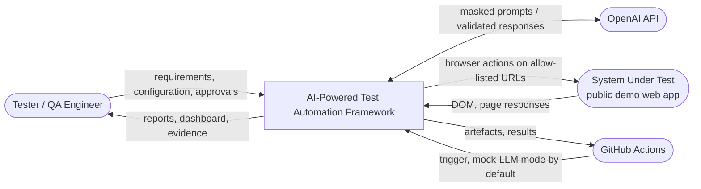
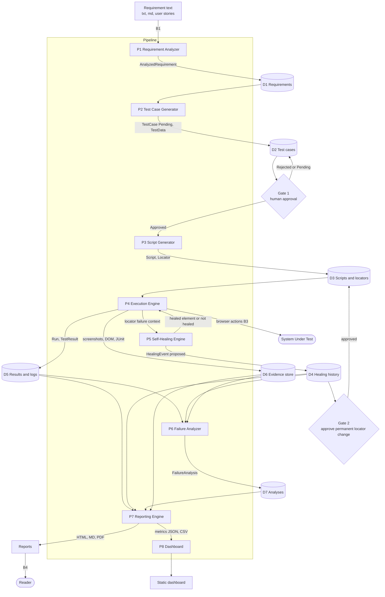
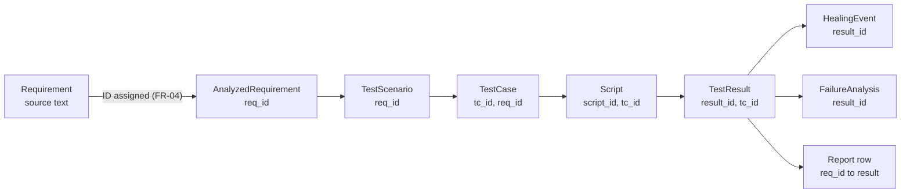
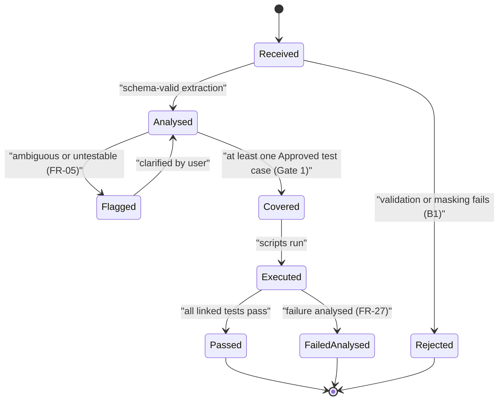
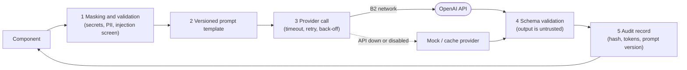
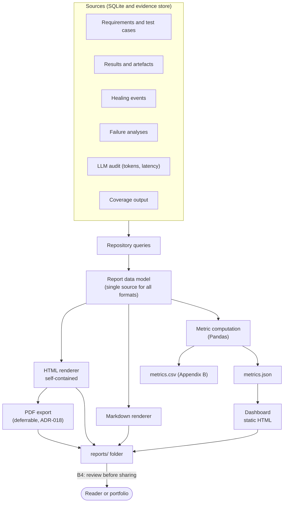

# 05 — Data Flow

**Version:** 1.0 · **Date:** 14 Nov 2026 · **Feeds:** Unit 3 AA Q1a ("system components and their interactions"), Report §3.3 Data Flow and System Components, §3.4 Design Diagrams (DFD) · **Design only, no code**
**Sources:** `01_SYSTEM_ARCHITECTURE.md` (components, interactions A1–A17, gates), `02_COMPONENT_ARCHITECTURE.md` (module inputs and outputs), `SYSTEM_REQUIREMENTS/` (FR/NFR), `07_SECURITY_ETHICS_CONTROLS.md` (trust boundaries B1–B4).
**Companion:** `06_SEQUENCE_FLOW.md` covers module communication, error handling and time-ordered behaviour.

*AI-generated draft: review before submission.*

## 1. Executive Summary

Data moves through the framework as **versioned, schema-validated records** stored in SQLite Persistence (structured data) and an evidence store (files). Every record carries the run ID and the IDs of the records it came from, which gives the end-to-end traceability required by FR-34. The only point where project data leaves the machine is the LLM Gateway, which masks before sending, validates what returns and writes an audit record; four trust boundaries (B1–B4) are marked on the diagrams. This file covers the **requirement flow** (§5), the **data flow** (§2–4, 6), the **reporting flow** (§7) and the data lifecycle (§8); module communication and error handling are in `06`.

## 2. Level 0 — Context Diagram

## 3. Level 1 — Data Flow Diagram

Processes follow the canonical modules; stores D1–D7 are logical groups of SQLite tables or files.

Every process also writes events to Audit Logging, and every process that calls a model does so through the LLM Gateway (§6).

## 4. Data Dictionary

| Record | Produced by | Consumed by | Key fields | Store |
|---|---|---|---|---|
| `AnalyzedRequirement` | Requirement Analyzer | Test Case Generator, Reporting | req_id, source_ref, content_hash, actors, actions, preconditions, outcomes, risk, risk_rationale, ambiguity_flags, prompt_version, ai_label | D1 |
| `TestScenario` | Test Case Generator | Test Case Generator | scenario_id, req_id, type (positive, negative, boundary) | D2 |
| `TestCase` | Test Case Generator | Script Generator, Reporting | tc_id, scenario_id, req_id, steps, expected, priority, review_status, ai_label | D2 |
| `TestData` | Test Case Generator | Script Generator, Execution Engine | tc_id, dataset (synthetic) | D2 |
| `Script` | Script Generator | Execution Engine | script_id, tc_id, framework, path, validation_result | D3 |
| `Locator` | Script Generator, approved healing | Execution Engine, Self-Healing | loc_id, page, name, primary, fallbacks, version | D3 |
| `Run` | Orchestrator | all | run_id, started, status, config_hash, driver, environment, git_sha | D5 |
| `TestResult` | Execution Engine | Failure Analyzer, Reporting | result_id, run_id, tc_id, status, duration, error, retries, healed_flag, log_ref | D5 |
| `Artifact` | Execution Engine | Failure Analyzer, Reporting | result_id, type (screenshot, trace, dom, log, junit), path, sha256 | D6 + index in D5 |
| `HealingEvent` | Self-Healing Engine | Failure Analyzer, Reporting, review | result_id, loc_id, old, new, strategy, confidence, validated, approved, outcome | D4 |
| `FailureAnalysis` | Failure Analyzer | Reporting | result_id, category, cause, remediation, confidence, cluster_id, ai_label | D7 |
| `LlmAudit` | LLM Gateway | Reporting (cost, latency) | call_id, run_id, component, model, prompt_version, tokens_in, tokens_out, input_hash, status | audit table |
| `Report` | Reporting Engine | user, Dashboard | run_id, format, path, generated_at | files + index |

## 5. Requirement Flow (traceability and lifecycle)

A requirement is the unit that everything else is traced to (FR-34). Its identity is fixed at ingestion and carried through every later record.

### 5.1 Lineage

The reverse query (result → requirement) and the forward query (requirement → all results) must both be answerable from one database query (FR-34 acceptance criterion).

### 5.2 Requirement states

"Covered" drives the requirement coverage ratio (FR-39): requirements with at least one Approved test case divided by eligible requirements (those not Flagged or Rejected).

## 6. LLM Data Path and Trust Boundaries

| Data class | Leaves the machine? | Control |
|---|---|---|
| Requirement text (public or synthetic only) | Yes, after masking | FR-02, FR-30; NFR-15 |
| Trimmed DOM fragment, error text | Yes, after masking and size cap | FR-30; NFR-13 |
| API keys, credentials, personal data | **No** | Masking, environment-only secrets (NFR-09) |
| Screenshots | **No** (referenced by path only) | Not transmitted in the prototype |
| Audit record | No (local table) | Hash of input, no raw prompt or secret (FR-37) |

Trust boundaries: **B1** user or file → Requirement Analyzer; **B2** LLM Gateway → OpenAI; **B3** Execution Engine → system under test; **B4** Reporting Engine → reader (controls in `07` §2).

## 7. Reporting Flow

### 7.1 Report content (HTML report, FR-31)

| Section (summary first, NFR-29) | Source records |
|---|---|
| Run summary: pass, fail, healed, skipped; duration; driver | `Run`, `TestResult` |
| Requirement coverage table | `AnalyzedRequirement`, `TestCase` |
| Per-test detail with screenshot and log links | `TestResult`, `Artifact` |
| Healing events with confidence and approval state | `HealingEvent` |
| Failure analysis by category and cluster | `FailureAnalysis` |
| Metrics and cost | `LlmAudit`, computed metrics |
| Provenance: model, prompt versions, mock or live, commit | `Run`, `LlmAudit` |

### 7.2 Metric derivation (FR-33, FR-39; proposed definitions, fixed at Unit 5)

| Metric | Definition | Source |
|---|---|---|
| Pass rate | Passed ÷ executed (healed passes counted separately) | `TestResult` |
| Healing success rate | Validated healed events ÷ healing attempts, per strategy and mutation type | `HealingEvent`, mutation catalogue (FR-38) |
| Classification accuracy | Correct categories ÷ labelled failures in the hand-labelled set | `FailureAnalysis`, labelled set |
| Requirement coverage ratio | Requirements with ≥ 1 Approved case ÷ eligible requirements | `AnalyzedRequirement`, `TestCase` |
| Script executability rate | Scripts that pass static validation and run to the first assertion without framework error ÷ scripts generated | `Script`, `TestResult` |
| Generation latency | Median seconds per requirement for analysis plus generation | `LlmAudit`, stage timers |
| API cost per run | Tokens × configured price per token | `LlmAudit` |
| Code coverage | Line coverage from the coverage tool for the framework's own code | CI output |

All reports state whether the LLM was live or mock-generated, so mock results are never mistaken for model results (FR-36).

## 8. Data Lifecycle

| Stage | Data | Retention | Disposal |
|---|---|---|---|
| In run | Records, artefacts | Until the run ends | — |
| After run | Database and evidence store | Local; curated samples committed for the portfolio | Purge command (NFR-16) |
| CI | Uploaded artefacts | Set explicitly (proposed: 14 days for runs, 90 days for release evidence) | Automatic expiry |
| Audit | `LlmAudit` | With the database | With the database |

## 9. Alignment With Unit 3 Assignment

Q1a asks for "system components and their interactions": §3 (components and flows), §4 (what is exchanged) and `06` (how and when). The FR/NFR connection is shown by requirement IDs in the diagrams and the tables.

## 10. Open Items

1. Confirm CI artefact retention values (§8).
2. Metric definitions (§7.2) are proposals to be fixed at Unit 5 and recalibrated under ADR-017 if they change.
3. Whether screenshots may ever go to a vision-capable model (currently excluded for privacy and cost).
