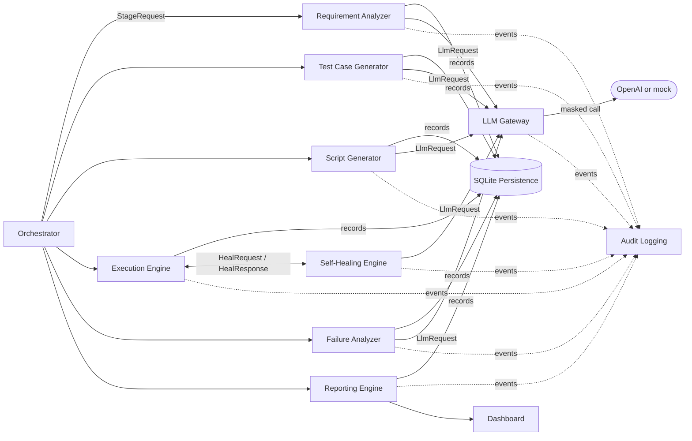
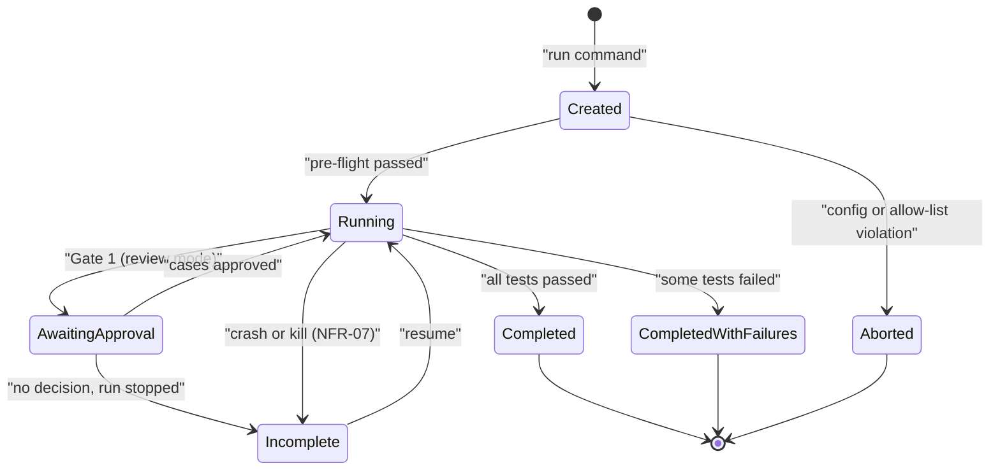
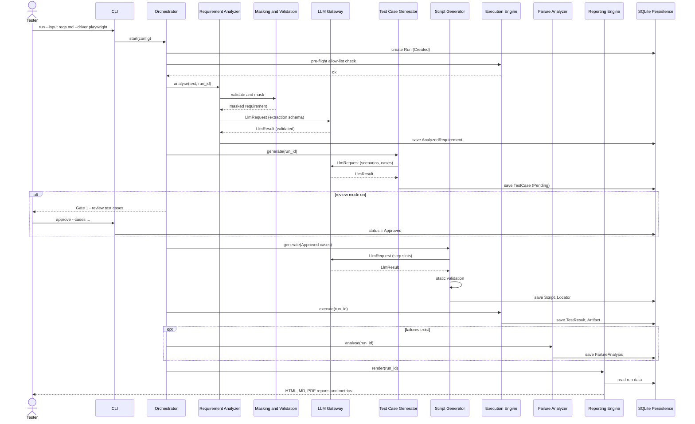
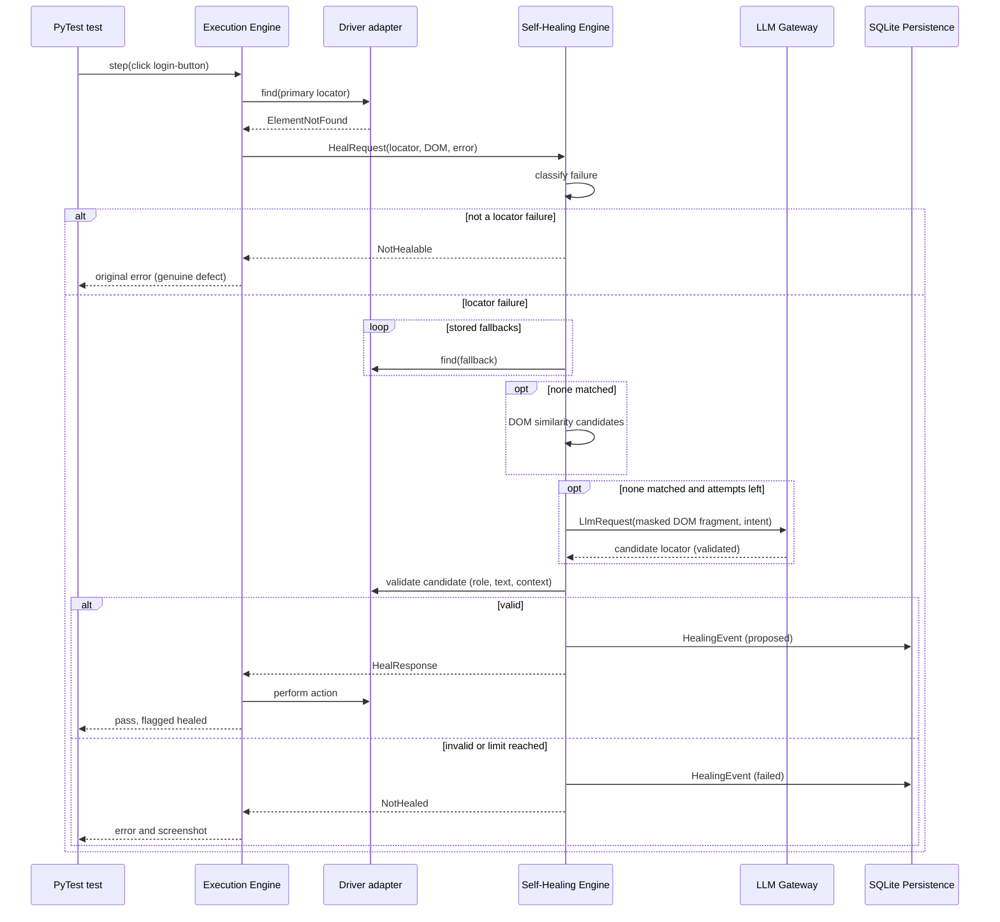
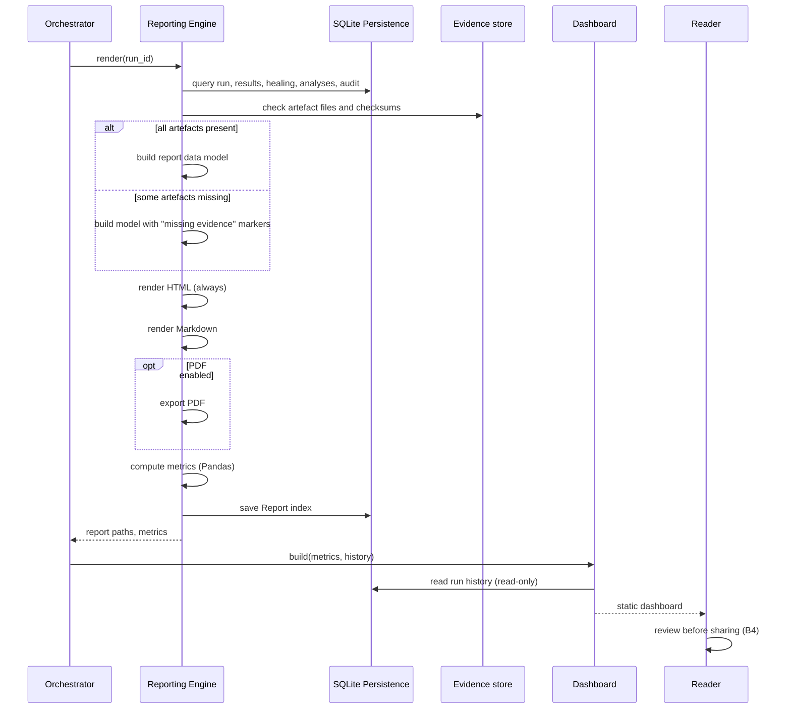
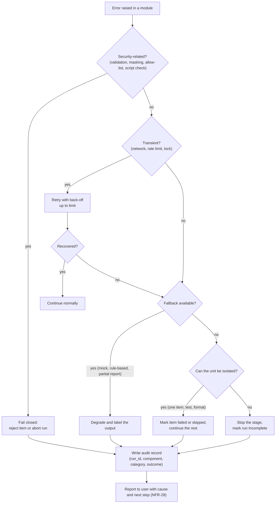
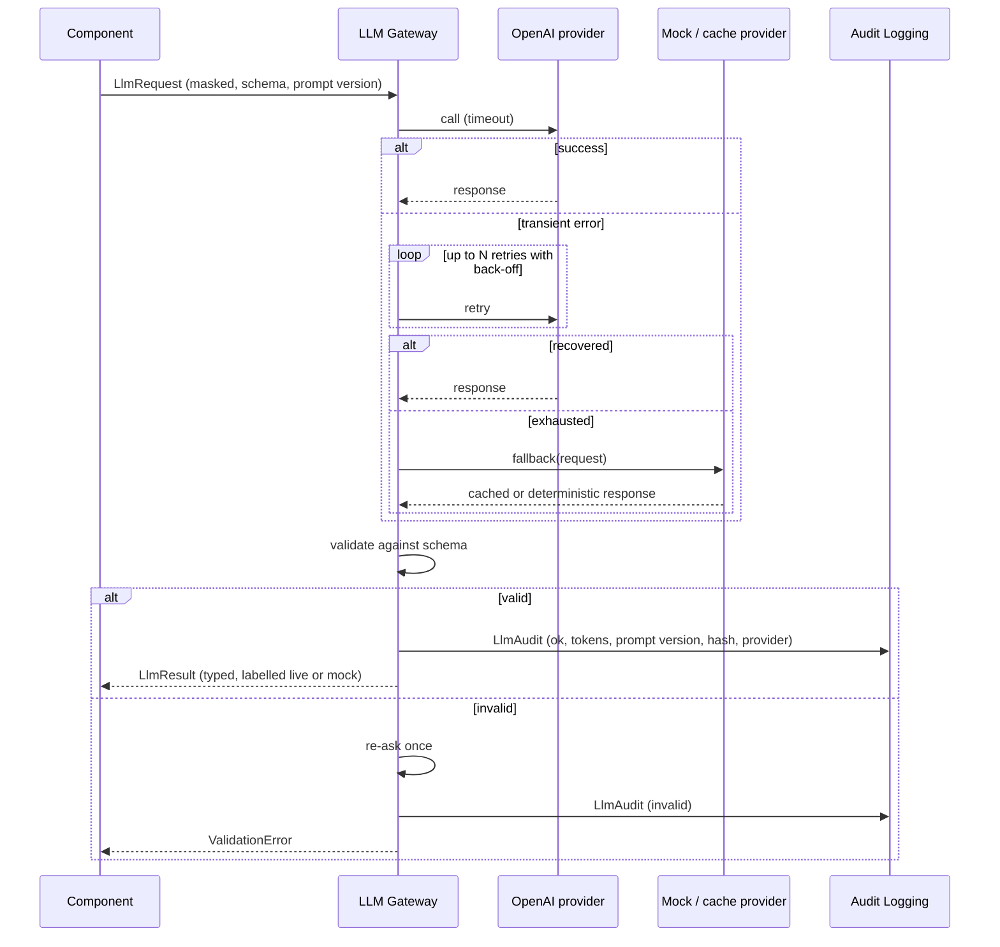

# 06 — Sequence Flow

**Version:** 1.0 · **Date:** 14 Nov 2026 · **Feeds:** Unit 3 AA Q1a (interactions), Report §3.4 Design Diagrams (UML sequence), §3.3 · **Design only, no code**
**Sources:** `01_SYSTEM_ARCHITECTURE.md` (interactions A1–A17, gates), `02_COMPONENT_ARCHITECTURE.md`, `05_DATA_FLOW.md`, `SYSTEM_REQUIREMENTS/`.
**Companion:** `05_DATA_FLOW.md` covers data flows, requirement flow and reporting data.

*AI-generated draft: review before submission.*

## 1. Executive Summary

This file shows how modules talk to each other over time. It covers **module communication** (§2–3), the **requirement-to-report sequence** (§4), **self-healing** (§5), the **reporting flow** (§6) and the **error handling flow** (§7–9). Three communication styles are used: hand-over through SQLite Persistence, one synchronous interface call (Execution Engine to Self-Healing Engine), and calls through the LLM Gateway. Two human gates and a run state machine make the behaviour predictable when something fails.

## 2. Module Communication

### 2.1 Styles

| Style | Used for | Why |
|---|---|---|
| **Persistence hand-over** | Between pipeline stages (A6–A8, A13–A16) | Stages stay decoupled, can be re-run alone (FR-35), and an interrupted run can resume (NFR-07) |
| **Interface call** | Execution Engine ⇄ Self-Healing Engine (A10); all components → Audit Logging (A17) | Healing must happen inside the failing step; logging must not wait on the pipeline |
| **Gateway call** | Any LLM use (A4, A5) | One place for masking, validation, audit and fallback (ADR-006) |
| **No direct module-to-module calls** otherwise | — | Enforced by the import rules (NFR-17) |

### 2.2 Message contracts

| Exchange | Message | Validation at receiver | Failure meaning |
|---|---|---|---|
| Orchestrator → module | `StageRequest` (run_id, config, input refs) | Config schema | Config error: stage not started |
| Module → Persistence | One record type per stage (`05` §4) | Schema and foreign-key check | Persistence error (§7) |
| Component → Gateway | `LlmRequest` (task, masked payload, output schema, prompt version) | Masking done, size within cap | Request refused |
| Gateway → component | `LlmResult` (typed, validated) or `LlmError` (kind, retryable) | Output schema | Component decides: re-ask once or flag |
| Execution Engine → Self-Healing | `HealRequest` (locator, DOM snapshot, error, limits) | Required fields present | "Not healable" |
| Self-Healing → Execution Engine | `HealResponse` (healed element, strategy, confidence) or `NotHealed` (reason) | Role, text and context match | Step fails with the original error |

### 2.3 Who talks to whom (summary)

## 3. Run State Machine

## 4. Sequence A — Requirement to Report (end-to-end)

Every call to `GW` also produces an audit record; this is omitted from the diagram for readability.

## 5. Sequence B — Self-Healing During Execution

**Gate 2.** A healed locator applies to the current run only. It becomes part of the locator repository after a human approves the `HealingEvent` (FR-25); until then reports mark it "proposed".

## 6. Sequence C — Reporting Flow

## 7. Error Handling Flow

### 7.1 Principles

1. **Fail closed** on anything that touches security (validation, masking, allow-list, static script check): nothing proceeds on doubt.
2. **Contain** an error at the smallest unit (one requirement, one test, one report format) and continue the rest where safe.
3. **Retry only what is transient** (network, rate limit, timeout), with back-off and a limit.
4. **Degrade visibly:** fall back to the mock provider or a partial report, and always label the result.
5. **Record every error** with run ID, component, category and outcome (audit log); never record secrets (NFR-09, NFR-14).
6. **Never mask a defect as success:** healing is flagged, unvalidated healing is rejected.

### 7.2 Error taxonomy and responses

| # | Error | Detected by | Response | Retry | Recorded as | Result for user | Req. |
|---|---|---|---|---|---|---|---|
| E1 | Input invalid (size, encoding, format, injection pattern) | Masking and Validation | Reject that requirement; continue others | No | Audit: input_rejected | Reason shown; requirement marked Rejected | FR-02; NFR-10, 13 |
| E2 | Masking fails or cannot be confirmed | Masking Layer | **Fail closed**: no LLM call for that item | No | Audit: masking_failed | Item skipped with reason | FR-30; NFR-15 |
| E3 | LLM transient (timeout, 429, 5xx) | Gateway | Retry with back-off up to N, then mock/cache fallback | Yes (N) | LlmAudit: retried, fallback | Output labelled mock-generated | FR-36; NFR-06 |
| E4 | LLM output invalid (schema) | Gateway | Re-ask once; if still invalid return `ValidationError` | Once | LlmAudit: invalid | Component flags item, no unvalidated data passes | NFR-10 |
| E5 | Ambiguous requirement | Requirement Analyzer | Flag; exclude from generation | No | Flagged | Clarification list | FR-05 |
| E6 | Generated script fails static validation | Script Generator | Reject script; do not save or run | Regenerate once, then flag | Audit: script_rejected | Test case marked "not scriptable" | FR-15; NFR-11 |
| E7 | Target URL not allow-listed | Execution Engine pre-flight | **Abort run** before any browser action | No | Run: Aborted | Clear message naming the URL | FR-21 |
| E8 | Locator failure | Execution Engine → Self-Healing | Healing ladder (§5) | Bounded attempts | HealingEvent | Healed (flagged) or failed with screenshot | FR-22–26 |
| E9 | Assertion or application defect | Execution Engine | Record failure; no healing; continue other tests | Per retry setting | TestResult: failed | Failure analysed | FR-17, 27 |
| E10 | Flaky or timing failure | Execution Engine | Retry per configuration; record retry count | Yes (config) | TestResult: retries | Classified "timing or flaky" if it still fails | FR-20, 27 |
| E11 | Environment failure (browser crash, SUT down) | Execution Engine | Mark affected tests "infrastructure"; stop the run if the SUT is unreachable | Limited | TestResult: error | Run summary names the cause | FR-27; NFR-05 |
| E12 | Healing limit reached | Self-Healing | Return `NotHealed`; test fails | No | HealingEvent: limit | Failure reported | FR-26 |
| E13 | Persistence error (locked, disk full, corrupt) | SQLite Persistence | Retry short-lived locks; otherwise stop the stage and mark run Incomplete | Short | Run: Incomplete | Message with remedy; resume possible | NFR-07 |
| E14 | Process crash or kill | Orchestrator on restart | Detect Running state without heartbeat; mark Incomplete; allow resume | — | Run: Incomplete | Resume or report as incomplete | NFR-07 |
| E15 | Report artefact missing or render failure | Reporting Engine | Produce HTML with "missing evidence" markers; skip failed format; never skip HTML | No | Report: partial | Warning in report and console | FR-31; NFR-33 |
| E16 | Failure analysis LLM unavailable | Failure Analyzer | Use rule-based result only; confidence lowered | Via E3 | FailureAnalysis: rule-only | Category without narrative | FR-27 |
| E17 | Secret found in output or log | Masking Layer, CI scan | Block publish; fail the CI check | No | Security event | Run flagged; key rotation advised | NFR-09, 14 |

### 7.3 Generic error flow

### 7.4 Sequence D — LLM Gateway with Fallback (errors E3, E4)

### 7.5 Exit status (proposed for the CLI, FR-35)

| Code | Meaning |
|---|---|
| 0 | Completed, all tests passed |
| 1 | Completed with test failures |
| 2 | Configuration or input error (E1, E5 for all items) |
| 3 | Aborted by policy (E7, E17) |
| 4 | Incomplete or internal error (E13, E14) |

## 8. Gate and Control Summary

| Point | Control | Reference |
|---|---|---|
| Before any LLM call | Validate and mask; fail closed | FR-02, 30 |
| After any LLM call | Schema validation; audit | NFR-10; FR-37 |
| After test-case generation | **Gate 1** human approval | FR-10; NFR-31 |
| Before script is saved | Static validation | FR-15 |
| Before run | Allow-list pre-flight | FR-21 |
| During execution | Locator vs defect; healing validated and flagged | FR-22–24 |
| Before permanent locator change | **Gate 2** approval | FR-25; NFR-31 |
| Before sharing outputs | Review at B4 | `07` §2 |

## 9. Alignment With Unit 3 Assignment

Q1a asks for "system components and their interactions". Interactions are shown as the communication styles and contracts (§2), the end-to-end, healing and reporting sequences (§4–6), and the failure behaviour (§7). Requirement IDs appear throughout, so the NFR influence on design (reliability, security, usability) is visible.

## 10. Open Items

1. Retry count N, back-off values and healing attempt limits are fixed at Unit 5 and logged under ADR-017 if they change.
2. Confirm whether review mode is on by default (recommended: on for evaluation runs, off for CI smoke runs).
3. Confirm the proposed CLI exit codes (§7.5).
