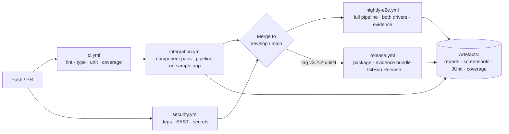

# 08 — GitHub Actions CI/CD Design

**Status:** Draft v0.2 (design only; no workflow files created) · **Feeds:** Unit 4 (CI/CD Reflection), Report §3.2 (CI/CD as 3.2.x) and §4.1 · **Extends:** `cicd/PIPELINE_STRATEGY.md`

## 1. Executive Summary

Five GitHub Actions workflows implement a **shift-left quality pipeline**: fast checks on every push/PR, integration checks on PRs to `develop`/`main`, a scheduled end-to-end run against the local sample app, a dedicated security workflow, and a tag-triggered release that packages academic evidence. Deterministic **mock-LLM mode** is the default in CI (no cost, no flakiness, no secrets on pull requests); a small, manually dispatched job exercises the real OpenAI API. This design stays within the approved stack and extends the existing strategy (Commit → Build → Unit → Integration → Report → Artefacts).

The legacy strategy lists **Allure Reports**, which is not in the approved stack. This design uses native HTML/Markdown/PDF reports (approved in `MASTER_CONTEXT.md`) and PyTest's JUnit XML; Allure is an optional add-on pending your decision.

## 2. Pipeline Overview

## 3. Workflow Specifications

### 3.1 `ci.yml` — Fast feedback (required check)

| Item | Design |
|---|---|
| Triggers | `push` (all branches), `pull_request` → `develop`, `main` |
| Concurrency | Cancel in-progress runs per ref |
| Matrix | OS: `ubuntu-latest`, `windows-latest` · Python: `3.12` (approved version; NFR-26) |
| Steps | checkout → setup-python with pip cache → install `requirements*.txt` → **lint/format check** → **type check (`core`)** → **import-rule check** (NFR-17) → **unit tests** (mock LLM) with coverage → enforce coverage threshold → upload JUnit + coverage |
| Gates | Coverage ≥ 80% (NFR-18); lint clean; import rules clean |
| Target duration | ≤ 5 min |
| Secrets used | None |

### 3.2 `integration.yml` — Integration tests

| Item | Design |
|---|---|
| Triggers | `pull_request` → `develop`, `main`; `workflow_dispatch` |
| Needs | `ci.yml` success |
| Matrix | Driver: `playwright`, `selenium` (Chrome headless) |
| Steps | install deps → `playwright install --with-deps chromium` → start `sample-apps` static server → run `tests/integration` (mock LLM, recorded responses) → capture screenshots/JUnit → generate reports |
| Verifies | Component contracts, DB persistence, script generation → execution → healing → analysis → report on the sample app |
| Artefacts | `reports/`, `evidence/ci/`, JUnit (retention 14 days) |
| Secrets used | None |

### 3.3 `nightly-e2e.yml` — Scheduled end-to-end and evaluation

| Item | Design |
|---|---|
| Triggers | `schedule` (nightly, off-peak), `workflow_dispatch` with input `llm_mode: mock | live` |
| Steps | full pipeline from sample requirements → both drivers → inject locator breakages from a catalogue → collect metrics (pass rate, healing success rate, classification accuracy, runtime) → append to metrics history → render dashboard |
| `live` mode | Uses `OPENAI_API_KEY` from an **Environment secret** with required reviewer; spend cap and call-count cap enforced by the Gateway; only dispatched manually |
| Outputs | Dashboard + metrics JSON artefact (retention 30 days); drives Unit 6 evaluation data and NFR-05 measurement |
| Failure handling | Opens/updates a GitHub Issue labelled `nightly-failure` |

### 3.4 `security.yml` — Security gates (required check)

| Item | Design |
|---|---|
| Triggers | `pull_request`, `push` to `develop`/`main`, weekly schedule |
| Jobs | Dependency audit (`pip-audit`) · SAST (CodeQL for Python) · secret scan (gitleaks or GitHub secret scanning) · generated-script policy tests (FR-15) |
| Gate | No high/critical findings (NFR-12) |
| Permissions | `contents: read`, `security-events: write` only |
| Mapping | OWASP Top 10 categories: A06 vulnerable components, A02/A07 secret handling, A03 injection (script policy tests) |

### 3.5 `release.yml` — Unit-gate release and evidence bundle

| Item | Design |
|---|---|
| Trigger | Push of tag `v*.*.*` (created only from `main`) |
| Steps | checkout → verify tag is on `main` → run full tests → build sdist/wheel → build evidence bundle from `evidence/unitNN` + sample reports + coverage → generate `CHANGELOG` excerpt → create GitHub Release with attachments |
| Permissions | `contents: write` (this workflow only) |
| Output | Release page = the stable submission snapshot per unit (retention 90 days for build artefacts; release assets permanent) |

## 4. Environments, Secrets and Permissions

| Item | Policy |
|---|---|
| Default `GITHUB_TOKEN` permissions | `contents: read` at repository level; elevate per job only |
| `OPENAI_API_KEY` | Stored as **Environment secret** (`llm-live`) with required approval; never exposed to PR workflows from forks; never echoed |
| Fork PRs | Run with mock LLM and no secrets; `pull_request` (not `pull_request_target`) |
| Third-party actions | Pinned to full commit SHA; Dependabot updates them |
| Logs | Secret masking verified by a test that greps logs for key patterns (NFR-09) |
| Self-hosted runners | Not used |

## 5. Quality Gates Summary

| Stage | Gate | Source requirement |
|---|---|---|
| Lint / format / types | Zero errors | NFR-19 |
| Import rules | Zero forbidden imports | NFR-17 |
| Unit tests | 100% pass; coverage ≥ 80% (≥ 90% healing/failure logic) | NFR-18 |
| Integration | 100% pass on both drivers | FR-17 |
| Security | 0 high/critical; 0 secrets | NFR-09, 12 |
| Cross-platform | Ubuntu + Windows pass | NFR-26 |
| Release | Tag on `main`; all gates green | Git strategy |

Branch protection (see `project-management/GIT_STRATEGY.md` §7) makes `ci`, `security` and `integration` required status checks for merging.

## 6. Artefacts and Academic Evidence

| Artefact | Producer | Retention | Used for |
|---|---|---|---|
| JUnit XML, coverage HTML/XML | ci, integration | 14 d | Unit 5/7 test results (Ch 4.4, App B) |
| Screenshots, traces | integration, nightly | 14–30 d | Ch 4.3, Appendix A |
| HTML/MD/PDF run report | integration, nightly | 30 d | Ch 4.4–4.5 |
| Metrics JSON + dashboard | nightly | 30 d | Unit 6 evaluation (Ch 4.5–4.6) |
| Workflow run screenshots | Manual capture | Permanent in `evidence/` | Unit 4 reflection |
| Evidence bundle | release | Permanent (release asset) | Final submission |

CI-produced evidence is copied into `evidence/unitNN/` by a release PR so that submission evidence is version-controlled, not only held in expiring Actions storage.

## 7. Caching and Performance

- pip cache keyed on requirement-file hashes; Playwright browser cache keyed on version.
- Path filters: docs-only changes (`docs/**`, `*.md`) skip browser jobs but still run lint of links/markdown.
- Concurrency groups avoid redundant runs.

## 8. Rollout Plan (aligned with units)

| Unit | CI/CD scope delivered |
|---|---|
| 3 | This design + minimal docs-lint workflow on the new repo (optional) |
| 4 | `ci.yml`, `security.yml`, branch protection, badges; **evidence E03: one green run, plus one deliberate red run and its fix**; Requirement Analyzer / Test Case Generator spike runs in CI (roadmap M6) |
| 5 | Unit-test coverage gating on real algorithms; evidence capture; `release.yml` for tags `v0.1.0` and `v0.5.0` (roadmap M9, E17) |
| 6 | `integration.yml`, `nightly-e2e.yml`, metrics history; Docker image build job (roadmap M13, E15); tag `v1.0.0-rc1` |
| 7 | Cross-platform matrix hardening; maintenance workflows (Dependabot) |
| 8 | Final evidence bundle; tag `v1.0.0`; GitHub Pages publish job for the portfolio and dashboard (roadmap M22, E19) |

## 9. Comparison Notes (for Unit 4 reflection)

GitHub Actions is chosen as approved and because it is integrated with the hosting platform, has a free tier suitable for a student project, and provides OIDC/Environments for secret control. Alternatives (Azure DevOps, GitLab CI, Jenkins) are discussed only as comparisons (roadmap issue I-9).

## 10. Risks

| Risk | Mitigation |
|---|---|
| Free-tier minutes exhausted | Path filters, caching, nightly only, single browser |
| Browser flakiness in CI | Retries with flake recording, pinned browser versions |
| Live-LLM cost overrun | Manual dispatch only, call/spend caps, mock default |
| Windows runner slowness | Run browser jobs on Ubuntu only; Windows for unit tests |

## 11. Open Items

1. Allure: adopt (optional) or drop from `cicd/PIPELINE_STRATEGY.md`.
2. Confirm the nightly cadence and the live-LLM budget (`MASTER_PLAN.md` O-4; roadmap risk R4).
3. Confirm third-party tools (CodeQL, pip-audit, gitleaks) are acceptable additions; they are tooling, not architecture, but are not on the approved list.
