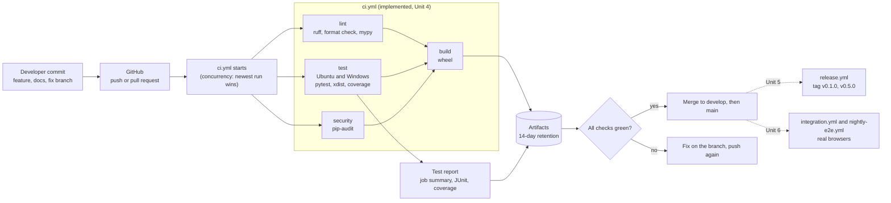
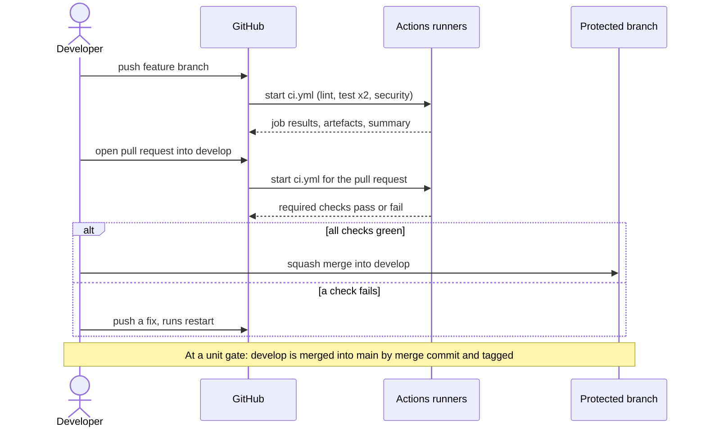

# 08 — GitHub Actions CI/CD Design

**Version:** 1.0 · **Date:** 14 Nov 2026 · **Feeds:** Unit 4 (source material and evidence for the CI/CD reflection paper), Report §3.2 (CI/CD as 3.2.x)
**Related:** `cicd/CI_CD_WORKFLOW.md` (operational walkthrough, tool comparison, paper source map), repository `.github/workflows/ci.yml`, `project-management/GIT_STRATEGY.md`, decisions ADR-025 (tooling) and ADR-026 (OpenAI budget), requirements NFR-12, NFR-17 to NFR-19, NFR-26.

*AI-generated draft: review before use. This file is not the Unit 4 paper.*

## 1. Executive Summary

The project uses **GitHub Actions** (approved stack) for continuous integration: every push and pull request is automatically linted, type-checked, unit-tested on Windows and Linux with coverage, audited for vulnerable dependencies, built into a wheel, and published as downloadable artefacts. The first workflow, `ci.yml`, is **written and its commands pass locally**, but it **has not yet run on GitHub**; evidence E03 (one green run, one deliberate red run and its fix) is still to be captured. Continuous *delivery* is deliberately small: this is a prototype evaluated on public demo apps (ADR-001), so there is no deployment environment. "Delivery" means a versioned wheel and an evidence bundle attached to tagged releases.

Tooling follows ADR-025: pip-audit, pytest-xdist and GitHub's built-in secret scanning are used; CodeQL, gitleaks and Allure are not; Docker arrives in Unit 6 if available. Tests and CI use the mock LLM provider and no secrets (ADR-026).

## 2. Pipeline Overview

## 3. Workflows

| Workflow | Status | Trigger | Purpose |
|---|---|---|---|
| `ci.yml` | **Implemented** (Unit 4; passes locally, not yet run on GitHub) | push (all branches), pull request to `develop` or `main`, manual | Lint, type check, unit tests and coverage on two operating systems, dependency audit, build, artefacts |
| `release.yml` | Planned, Unit 5 | tag `v*` on `main` | Run all checks again, build wheel, create GitHub Release with changelog and evidence bundle |
| `integration.yml` | Planned, Unit 6 | pull request to `develop` or `main`, manual | Real Playwright and Selenium runs against the local sample app, Ubuntu only, mock LLM, screenshots as artefacts |
| `nightly-e2e.yml` | Planned, Unit 6 | schedule, manual with `llm_mode: mock or live` | Evaluation run with seeded locator mutations; metrics history; live mode only manually, in a protected environment, within the $5 cap |
| Docker image build | Planned, Unit 6, conditional (ADR-025) | inside `integration.yml` | Build only, no registry push |

## 4. `ci.yml` Specification

| Item | Design |
|---|---|
| Triggers | `push` on all branches, `pull_request` into `develop` or `main`, `workflow_dispatch` |
| Concurrency | One run per branch or pull request; a newer push cancels the older run |
| Permissions | `contents: read` only. No secrets are referenced anywhere in the file |
| Environment | Python 3.12 (ADR-000); `LLM_PROVIDER=mock` so no live API call is possible |
| Caching | pip cache keyed on `requirements-dev.txt` |

| Job | Runner | Steps | Fails when | Artefacts |
|---|---|---|---|---|
| `lint` | ubuntu-latest | checkout, Python, install, `ruff check`, `ruff format --check`, `mypy src` | Any lint, format or type error | none |
| `test (ubuntu-latest)`, `test (windows-latest)` | both | checkout, Python, install, editable install, `pytest -n auto` with coverage and JUnit, job summary, upload | A test fails, coverage below 80%, or a runner OS fails | `test-reports-<os>`: `junit.xml`, `coverage.xml`, `htmlcov/` |
| `security` | ubuntu-latest | checkout, Python, install, `pip-audit -r requirements.txt` (JSON report) | A known vulnerability is found | `security-report`: `pip-audit.json` |
| `build` | ubuntu-latest | needs `lint`, `test`, `security`; builds a wheel | Any earlier job fails, or the package does not build | `aitaf-dist`: wheel |

Test report generation: besides the downloadable JUnit XML and the coverage HTML, each test job writes a small table (tests, passed, failed, errors, skipped) to the job summary page, so the result is visible without opening the logs.

## 5. Quality Gates

| Gate | Tool | Threshold | Requirement |
|---|---|---|---|
| Lint and format | ruff | zero errors | NFR-19 |
| Type check | mypy (strict, on `src`) | zero errors | NFR-19 |
| Unit tests | pytest | all pass | NFR-18 |
| Coverage | pytest-cov | at least 80% overall (healing and failure-classification logic at least 90% once those modules exist) | NFR-18 |
| Dependency audit | pip-audit | no known vulnerabilities | NFR-12 |
| Platforms | matrix ubuntu and windows | both green | NFR-26 |
| Build | pip wheel | wheel builds | NFR-20 |
| Import rules (module independence) | to be added with Unit 5 | zero forbidden imports | NFR-17 |

## 6. How CI Supports the Modules

Everything below runs in `ci.yml` with the **mock LLM provider** and **fake browser drivers**, so it is fast, free and repeatable (NFR-08). Real browsers belong to `integration.yml` in Unit 6.

| Module | What CI verifies | Test types | Later (Unit 6) | Requirements |
|---|---|---|---|---|
| **Requirement Analyzer** | Records match the `AnalyzedRequirement` schema; oversized, mis-encoded and injection-pattern inputs are rejected and logged; ambiguous wording is flagged; identical input gives identical IDs and output with the mock provider | Unit tests with fixtures; negative tests | Pipeline run on the sample requirement set | FR-01 to FR-05; NFR-08, 10, 13 |
| **Test Case Generator** | Scenarios of each type exist; test cases have all fields; duplicates collapse; a Pending case is never passed on in review mode; synthetic data contains no personal-data patterns | Unit tests; schema tests; negative gate test | Coverage ratio metric on the sample set | FR-06 to FR-11; NFR-15, 31 |
| **Script Generator** | Generated scripts are valid Python; scripts with forbidden calls (`os.system`, `eval`) or embedded secrets are rejected; locators sit in one repository file per page with primary and fallback strategies; template output is deterministic | Unit tests; static-analysis fixtures | Scripts executed for real against the sample app | FR-12 to FR-16; NFR-11 |
| **Execution Engine** | A non-allow-listed URL aborts before any browser action; results, durations and artefacts are persisted and queryable; failure hooks create screenshot records; the healing interface is called only on locator failures. All against fake drivers | Unit tests with fakes; persistence tests | `integration.yml`: Playwright and Selenium on the sample app, screenshots uploaded | FR-17 to FR-21; NFR-04, 07, 11 |
| Self-Healing, Failure Analyzer, Reporting, Dashboard | Same pattern as units are built (Unit 5 and 6); coverage floor of 90% on healing and classification logic | Unit tests, labelled fixtures | Mutation evaluation in the nightly workflow | FR-22 to FR-33; NFR-18 |

In Unit 4 the first spike (Requirement Analyzer plus Test Case Generator on the mock provider, roadmap M6) runs in CI; before code exists the pipeline already guards the empty project with a smoke test.

## 7. Source Control Integration

- **Branch model** (`GIT_STRATEGY.md`): work on `feature/*`, `docs/*`, `fix/*`; pull request into `develop`; `develop` into `main`. The pipeline runs on every push and on pull requests to the two permanent branches.
- **Required status checks** for branch protection: `lint`, `test (ubuntu-latest)`, `test (windows-latest)`, `security`, `build`. Enable them after the first green run so GitHub knows the names.
- **Merge rule:** squash into `develop` from Unit 4 onward; merge commit into `main`.
- **Traceability:** commit messages cite FR/NFR IDs; each run is tied to one commit; artefacts are named per run.

## 8. Security and Secrets

| Item | Policy |
|---|---|
| Token permissions | `contents: read` at workflow level |
| Secrets in `ci.yml` | None. No live LLM calls in CI (ADR-026) |
| Live API key (Unit 6 only) | Repository environment `llm-live`, required reviewer, manual dispatch only, never available to pull-request workflows from forks |
| Secret scanning | GitHub built-in scanning and push protection (ADR-025) |
| Third-party actions | Pinned to major version tags (`@v4`, `@v5`) today. **Hardening not yet done:** pin to full commit hashes and let Dependabot update them |
| Vulnerable dependencies | pip-audit in CI; Dependabot version updates (optional) |

## 9. Artefacts and Evidence

| Artefact | Producer | Retention | Used for |
|---|---|---|---|
| JUnit XML, coverage XML and HTML | `test` jobs | 14 days | Unit 5 test evidence (E07, E08), Appendix B |
| Dependency audit JSON | `security` | 14 days | NFR-12 evidence |
| Wheel | `build` | 14 days | Release input |
| Workflow run screenshots | Manual | Permanent in `evidence/` | **E03**, Unit 4 paper |

**E03 procedure:** (1) push a branch and capture the green run (E03a); (2) on a throw-away branch add a deliberately failing test, push, capture the red run showing which job failed (E03b); (3) fix and push, capture the green run again (E03c); (4) register all three in `evidence/EVIDENCE_REGISTER.md`. Do not describe pipeline results in any paper before these exist.

## 10. Sequence: Pull Request to Merge

## 11. Cost and Performance

Pip caching, concurrency cancellation, job timeouts and a small matrix keep run time and minutes low (target under 5 minutes). Check GitHub's current terms for free minutes on public repositories. Browser jobs run on Ubuntu only, and only in Unit 6.

## 12. Risks

| Risk | Mitigation |
|---|---|
| Workflow fails on GitHub although it passes locally (runner differences) | Run it early; E03 evidence; fix quickly; `workflow_dispatch` allows re-runs |
| Required-check names not known before the first run | Enable branch protection after the first green run |
| Browser flakiness (Unit 6) | Retries with recorded counts; pinned browser versions |
| Minutes exhausted | Caching, concurrency, Ubuntu-only browser jobs |
| Overclaiming CD for a prototype | State that delivery is a wheel and evidence bundle, not a deployment |

## 13. Open Items

1. Run `ci.yml` on GitHub and capture E03a to E03c.
2. Decide whether to pin actions to commit hashes in Unit 7 hardening.
3. Add the import-rule check when the first module packages exist (Unit 5).
