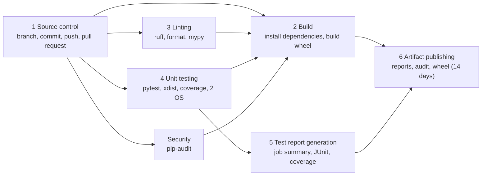

# CI/CD Workflow: Operational Walkthrough

**Version:** 1.0 · **Date:** 14 Nov 2026 · **Feeds:** Unit 4 CI/CD Reflection (source material only; the paper is written separately)
**Design:** `architecture/08_CICD_DESIGN.md` · **Implementation:** repository `.github/workflows/ci.yml` (full text in the appendix) · **Decisions:** ADR-025, ADR-026
**Status:** `ci.yml` is written; its commands pass locally and its YAML parses; **it has not run on GitHub yet** and evidence E03 does not exist yet.

*AI-generated draft: review before use.*

## 1. Overview



## 2. The Six Stages

### 2.1 Source control
- **What:** GitHub repository with `main`, `develop` and short-lived `feature/*`, `docs/*`, `fix/*` branches (`project-management/GIT_STRATEGY.md`).
- **How the pipeline attaches:** it starts on every push to any branch and on every pull request into `develop` or `main`, and can be started manually. A newer push to the same branch cancels the older run.
- **Result:** a run is tied to one commit; its status appears on the pull request and, once branch protection is enabled, blocks merging when a required check fails.

### 2.2 Build
- **What:** install pinned dependencies (`requirements-dev.txt`), install the project in editable mode for the tests, and in the final `build` job build a wheel with `pip wheel`.
- **Gate:** the `build` job runs only if `lint`, `test` and `security` succeed.
- **Output:** the wheel `aitaf-<version>.whl` as an artefact.

### 2.3 Linting
- **What:** `ruff check` (lint rules E, F, I, B, UP), `ruff format --check` (formatting), `mypy src` (strict type check).
- **Where:** job `lint`, Ubuntu. **Fails on** any finding.
- **Why:** NFR-19; keeps a solo project reviewable without a second reviewer.

### 2.4 Unit testing
- **What:** `pytest -n auto` (parallel workers) with coverage, run on **Ubuntu and Windows**. Coverage must be at least 80% (NFR-18). The mock LLM provider is forced through `LLM_PROVIDER=mock`, so no test can spend money or leak data.
- **Today:** one smoke test proves the package imports; real tests arrive with each module in Unit 5.
- **Not here:** browser-driven tests (Unit 6, `integration.yml`).

### 2.5 Test report generation
- **Job summary:** a small table (tests, passed, failed, errors, skipped) appears on the run page for each operating system.
- **Files:** `junit.xml` (machine-readable results), `coverage.xml`, and `htmlcov/` (browsable coverage report), uploaded even when tests fail.
- **Use:** screenshots of these pages feed evidence E07 and E08 in Unit 5.

### 2.6 Artifact publishing
| Artifact | Contents | Retention |
|---|---|---|
| `test-reports-ubuntu-latest`, `test-reports-windows-latest` | JUnit, coverage XML, coverage HTML | 14 days |
| `security-report` | `pip-audit.json` | 14 days |
| `aitaf-dist` | wheel | 14 days |

Release-grade artefacts (wheel and evidence bundle attached to a GitHub Release) come with `release.yml` in Unit 5.

## 3. Reading a Run

1. Repository → **Actions** → select the run. Jobs are listed on the left: `lint`, `test (ubuntu-latest)`, `test (windows-latest)`, `security`, `build`.
2. Open a failed job, expand the failing step, read the message.
3. The **Summary** tab shows the test table; **Artifacts** at the bottom lists the downloads.
4. Fix, commit, push: a new run starts and the old one is cancelled.

## 4. Local Equivalent (run before pushing)

With the repository environment active, from the repository folder:

1. `ruff check .`
2. `ruff format --check .`
3. `mypy src`
4. `pytest -n auto --cov=aitaf --cov-fail-under=80`
5. `pip-audit -r requirements.txt`

If all five pass, the pipeline should pass; differences are usually operating-system or network related.

## 5. Failure Handling and the E03 Demonstration

| Situation | Behaviour |
|---|---|
| Lint, test, security or build fails | The run is red; `build` is skipped; artefacts that exist are still uploaded |
| One operating system fails | The other still completes (`fail-fast` off), showing which platform broke |
| Newer push | Older run for the same branch is cancelled |
| Job hangs | Timeout (10 to 15 minutes) stops it |

**E03 (required evidence):** capture (a) a green run, (b) a deliberately red run (add a failing test on a throw-away branch, push, capture the failed job and the failing step), (c) the fix and the green run. Register the three screenshots in `evidence/EVIDENCE_REGISTER.md`.

## 6. How the Pipeline Supports the Modules

Summary (detail in `architecture/08_CICD_DESIGN.md` §6):
- **Requirement Analyzer:** schema, input-validation and injection fixtures; deterministic output on the mock provider.
- **Test Case Generator:** field completeness, duplicate removal, review gate (Pending is never scripted), synthetic data without personal-data patterns.
- **Script Generator:** generated code parses and passes the static policy (forbidden calls and secrets rejected); locators centralised with fallbacks.
- **Execution Engine:** allow-list abort, persistence, evidence hooks and healing hand-off tested with fake drivers; real Playwright and Selenium runs follow in `integration.yml`.

## 7. Tool Comparison (for the paper's tools aspect)

General characteristics only; the paper must cite official documentation or course readings for any claim, and the comparison should note the vendor point of view of each source.

| Criterion | GitHub Actions | Jenkins | GitLab CI/CD | Azure DevOps Pipelines |
|---|---|---|---|---|
| Hosting | Built into GitHub; hosted runners or your own | Self-hosted server you operate | Built into GitLab; shared or own runners | Microsoft service with hosted or self-hosted agents |
| Configuration | YAML in `.github/workflows/` | Pipeline as code (Jenkinsfile) or UI jobs, plugin-based | YAML `.gitlab-ci.yml` | YAML or visual designer |
| Strength | Tight link to repository, pull requests and a large action marketplace | Highly flexible, large plugin ecosystem, no vendor lock-in | Single platform covering repository, CI/CD and registry | Integrated boards, repos, pipelines and artefacts; strong in Microsoft environments |
| Cost or effort | Convenient for small projects; check current free allowances | Free software but you maintain the server and plugins | Free and paid tiers | Free and paid tiers |
| Fit for this project | **Chosen** (approved stack; the repository already lives on GitHub; no server to run) | Overkill for a solo prototype | Would require moving the repository | Would add a second platform; used here only as a comparison (the Unit 4 video covers it) |

## 8. Source Map for the Unit 4 Paper (do not treat as the paper)

Assignment aspects, minimum 850 and maximum 1,000 words, APA 7, double-spaced, Times New Roman 12, reference list excluded from the count.

| Aspect | Project material to draw on | Course reading to connect to (cite explicitly) |
|---|---|---|
| 1. Define CI/CD and relevance | Pipeline overview (§1), quality gates (`08` §5) | Red Hat (2025) What is DevOps; Narasimhan et al. (2025) DevOps handbook; Parzych (2019) |
| 2. Tools and technologies | Tool comparison (§7), why GitHub Actions | Knowledge Academy (2023) Azure DevOps video; Parzych (2019); official documentation of each tool if extra sources are needed |
| 3. Collaboration, integration issues, delivery speed | Branch and pull-request flow with required checks (`08` §7, §10); concurrency, caching, parallel tests | Oguz (2025) Ch. 12 (Agile, Scrum, iterative delivery); Narasimhan et al. (2025); Laptick (2022) on prototypes validating a design |
| 4. Application to this project | `ci.yml` jobs, module support table (`08` §6), roadmap (Unit 5 release workflow, Unit 6 integration and nightly), limits and honest status | Laptick (2022) prototype model; Oguz (2025) |

Cautions for the writer:
- Describe the pipeline as **designed and verified locally**; mention actual GitHub results and E03 **only after they exist**.
- Do not claim continuous *deployment*: this prototype has no deployment target; delivery is a built wheel and evidence bundle.
- "Use information effectively" is scored: use a variety of sources (course readings plus at most a few official documents), and note the vendor perspective of Red Hat, Dell, XB Software and the training-video provider.
- Reference policy (ADR-020): course readings first, only verified register entries, no invented citations. The Unit 4 readings are already in `reference-library/MASTER_REFERENCES.md`: Oguz REF-001, Parzych REF-011, Narasimhan et al. REF-012, Red Hat REF-013, Laptick REF-014, GeeksforGeeks REF-015 (additional), Knowledge Academy video REF-016.

## 9. Appendix: `ci.yml` (as implemented)

```yaml
name: CI

# Fast feedback pipeline (Unit 4). Design: docs/architecture/08_CICD_DESIGN.md.
# Tests and CI never call the live LLM API (ADR-026); no secrets are used here.

on:
  push:
    branches: ["**"]
  pull_request:
    branches: [develop, main]
  workflow_dispatch:

concurrency:
  group: ci-${{ github.workflow }}-${{ github.ref }}
  cancel-in-progress: true

permissions:
  contents: read

env:
  PYTHON_VERSION: "3.12"
  LLM_PROVIDER: mock

jobs:
  lint:
    name: lint
    runs-on: ubuntu-latest
    timeout-minutes: 10
    steps:
      - name: Check out source
        uses: actions/checkout@v4
      - name: Set up Python
        uses: actions/setup-python@v5
        with:
          python-version: ${{ env.PYTHON_VERSION }}
          cache: pip
          cache-dependency-path: requirements-dev.txt
      - name: Install dependencies
        run: python -m pip install -r requirements-dev.txt
      - name: Lint (ruff)
        run: ruff check .
      - name: Format check (ruff)
        run: ruff format --check .
      - name: Type check (mypy)
        run: mypy src

  test:
    name: test (${{ matrix.os }})
    runs-on: ${{ matrix.os }}
    timeout-minutes: 15
    strategy:
      fail-fast: false
      matrix:
        os: [ubuntu-latest, windows-latest]
    steps:
      - name: Check out source
        uses: actions/checkout@v4
      - name: Set up Python
        uses: actions/setup-python@v5
        with:
          python-version: ${{ env.PYTHON_VERSION }}
          cache: pip
          cache-dependency-path: requirements-dev.txt
      - name: Install dependencies
        run: |
          python -m pip install -r requirements-dev.txt
          python -m pip install -e . --no-deps
      - name: Unit tests with coverage
        run: >
          pytest -n auto
          --cov=aitaf
          --cov-report=term-missing
          --cov-report=xml:reports/coverage.xml
          --cov-report=html:reports/htmlcov
          --cov-fail-under=80
          --junitxml=reports/junit.xml
      - name: Test report summary
        if: always()
        shell: python
        run: |
          import os
          import xml.etree.ElementTree as ET

          path = "reports/junit.xml"
          if os.path.exists(path):
              root = ET.parse(path).getroot()
              suite = root if root.tag == "testsuite" else root.find("testsuite")
              total, failed, errors, skipped = (
                  int(suite.get(k, 0)) for k in ("tests", "failures", "errors", "skipped")
              )
              passed = total - failed - errors - skipped
              body = f"| {total} | {passed} | {failed} | {errors} | {skipped} |"
          else:
              body = "| no report produced | | | | |"
          with open(os.environ["GITHUB_STEP_SUMMARY"], "a", encoding="utf-8") as fh:
              fh.write(f"### Unit test report ({os.environ['RUNNER_OS']})\n\n")
              fh.write("| Tests | Passed | Failed | Errors | Skipped |\n|---|---|---|---|---|\n")
              fh.write(body + "\n")
      - name: Upload test reports
        if: always()
        uses: actions/upload-artifact@v4
        with:
          name: test-reports-${{ matrix.os }}
          path: reports/
          retention-days: 14
          if-no-files-found: warn

  security:
    name: security
    runs-on: ubuntu-latest
    timeout-minutes: 10
    steps:
      - name: Check out source
        uses: actions/checkout@v4
      - name: Set up Python
        uses: actions/setup-python@v5
        with:
          python-version: ${{ env.PYTHON_VERSION }}
          cache: pip
          cache-dependency-path: requirements-dev.txt
      - name: Install dependencies
        run: python -m pip install -r requirements-dev.txt
      - name: Dependency vulnerability audit (pip-audit)
        run: |
          mkdir -p reports
          pip-audit -r requirements.txt -f json -o reports/pip-audit.json
      - name: Upload audit report
        if: always()
        uses: actions/upload-artifact@v4
        with:
          name: security-report
          path: reports/pip-audit.json
          retention-days: 14
          if-no-files-found: warn

  build:
    name: build
    needs: [lint, test, security]
    runs-on: ubuntu-latest
    timeout-minutes: 10
    steps:
      - name: Check out source
        uses: actions/checkout@v4
      - name: Set up Python
        uses: actions/setup-python@v5
        with:
          python-version: ${{ env.PYTHON_VERSION }}
      - name: Build wheel
        run: python -m pip wheel . --no-deps --wheel-dir dist
      - name: Upload build artifact
        uses: actions/upload-artifact@v4
        with:
          name: aitaf-dist
          path: dist/
          retention-days: 14
```
