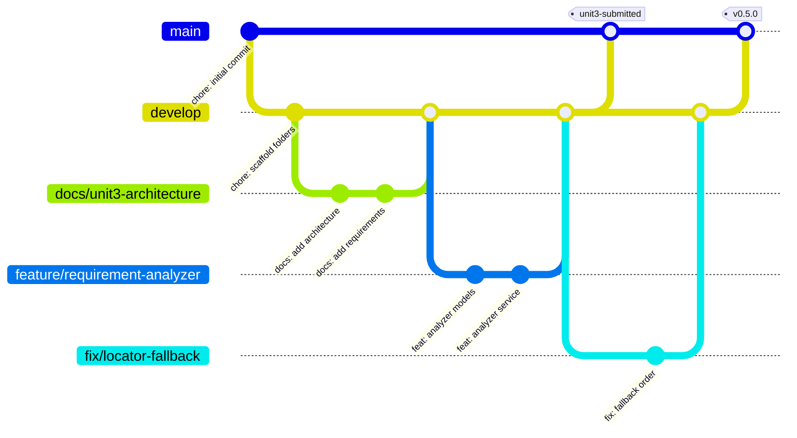

# Git Strategy

**Version:** 1.0 · **Date:** 14 Nov 2026 · **Feeds:** Unit 3 AA Q2 (Version Control and Collaboration), Unit 5 Part C (tags, releases, branching), Report §3.2 (Git as 3.2.x)
**Related:** `architecture/01_REPOSITORY_STRUCTURE.md` (full folder tree), `architecture/08_CICD_DESIGN.md` (workflows that enforce this strategy), `knowledge/PROJECT_DECISIONS.md` ADR-008 (status: **Proposed**, pending your confirmation), `knowledge/PROJECT_ROADMAP.md` (tag plan M9, M14, M22; evidence E01, E02, E17).
**Design only:** no repository has been created and no commands have been run.

*AI-generated draft: review before submission. Confirm the university's rules on AI-assisted work before using the optional commit trailer in §4.5.*

## 1. Executive Summary

The strategy is a **lightweight, protected two-branch model**: `main` holds reviewed, tagged, submittable work; `develop` integrates completed work; short-lived `feature/*` (plus `docs/*`, `fix/*`, `hotfix/*`) branches carry every change through a pull request. Commits follow the Conventional Commits format and cite requirement IDs, so history doubles as a requirement trace. Releases follow the roadmap's tag plan, with a plain `unitN-submitted` snapshot tag at each submission. This is proportionate for a solo, eight-unit project while satisfying all four Unit 3 Q2 aspects.

Assumption: solo project (open input O-3). Where peer review would normally exist, the pull-request checklist and automated checks act as the control, and the limitation is stated in the report.

### 1.1 Alignment with Unit 3 AA Question 2

| Q2 aspect (rubric: "all four implemented") | How this strategy meets it | Evidence to capture |
|---|---|---|
| a. Set up a Git repository (GitHub or GitLab) | GitHub repository `UoP_Capston_Project_dilip`, README, licence, `.gitignore`; instructor added as collaborator or repository public (§10) | E01: repository home page; settings showing access |
| b. Organise folders for source code, documentation and design files | `src/` (source), `tests/`, `docs/` (documentation), `docs/architecture/` including diagrams (design files), `evidence/` (§2) | E01: folder view |
| c. Clear commit messages documenting updates and progress | Conventional Commits with scope and FR/NFR references (§4); planned first commits in §10.2 | E02: commit history and `git log` graph screenshot |
| d. At least two branches (for example development and main) | `main` and `develop` permanent, plus at least one `feature/*` or `docs/*` branch merged by pull request (§3) | E01/E02: branch list, pull request, network graph |

Also required by the Q2 submission instructions: **the repository URL with viewing or contributor permissions** and a **1-page overview** of the branching approach and how version control ensures consistent documentation and traceability, in the same document as Q1. A draft is in §11. The rubric also scores sources and evidence and connection to course materials: the assigned readings are Davies (2024), Chapter 14 (team-based version control with Git) and Corbin (2025), the GitHub video; citations must be checked against the readings before use.

## 2. Repository Structure

Full tree and rationale: `architecture/01_REPOSITORY_STRUCTURE.md`. Summary relevant to Q2b:

```text
UoP_Capston_Project_dilip/
├── README.md  LICENSE  CONTRIBUTING.md  CHANGELOG.md  GLOSSARY.md
├── pyproject.toml  requirements.txt  requirements-dev.txt  .env.example  .gitignore
├── .github/                 # workflows, pull-request template, CODEOWNERS, dependabot
├── src/aitaf/               # SOURCE CODE: one package per canonical module + core
├── prompts/                 # versioned prompt templates
├── tests/                   # unit, integration, e2e, fixtures
├── sample-apps/             # local demo system under test
├── evaluation/              # Unit 6 mutation catalogue, labelled set, scripts, CSVs
├── docs/                    # DOCUMENTATION
│   ├── architecture/        #   DESIGN FILES: diagrams (.drawio and .png), design documents
│   ├── requirements/        #   FR and NFR catalogues
│   ├── project-management/  #   this strategy, risk register, schedule
│   ├── adr/                 #   architecture decision records
│   └── user-guide/
├── evidence/                # screenshots, logs, EVIDENCE_REGISTER.md
├── reports/                 # generated output (git-ignored; samples/ committed)
└── scripts/                 # developer helpers
```

| Q2b requirement | Folder |
|---|---|
| Source code | `src/aitaf/`, `tests/`, `prompts/`, `sample-apps/` |
| Documentation | `docs/`, `README.md`, `CHANGELOG.md` |
| Design files | `docs/architecture/` (diagram sources and exports, design documents) |

**Unit 3 state of the repository:** no code is written yet, so `src/` and `tests/` contain only placeholder files (a short README per folder) so the structure is visible and committed. Files that must never be committed: `.env`, `*.db`, raw evidence, secrets, client names or data (ADR-005).

## 3. Branch Structure



| Branch | Purpose | Created from | Merges into | Lifetime | Protection |
|---|---|---|---|---|---|
| `main` | Reviewed, tagged, submittable work | initial commit | — | permanent | See §3.1 |
| `develop` | Integration of completed work | `main` | `main` at unit gates | permanent | See §3.2 |
| `feature/*` | New functionality | `develop` | `develop` | ≤ 5 days | none |
| `docs/*` | Documentation, report, evidence | `develop` | `develop` | ≤ 3 days | none |
| `fix/*` | Defects found on `develop` | `develop` | `develop` | ≤ 2 days | none |
| `hotfix/*` | Defect found in a tagged release | `main` | `main` and `develop` | ≤ 1 day | none |

### 3.1 `main` branch

- **Role:** always in a state that could be submitted; every commit on it is either a merge from `develop` or a hotfix.
- **Who changes it:** only pull requests; direct pushes are blocked.
- **When it changes:** at each unit gate (submission) and for release tags.
- **Merge method:** merge commit from `develop`, which preserves the integration point and shows it clearly in the history graph.
- **Protection:** pull request required, no force-push, no deletion, linear-history rule not applied to this branch (merge commits are intended). Required status checks `lint`, `unit`, `security` once they exist (Unit 4 onward); until then pull request only. Required approvals set to 0 because the project is solo, with the pull-request checklist as the control.
- **Contents rule:** no half-finished work and no failing checks.

### 3.2 `develop` branch

- **Role:** integration branch; where completed features, documentation and fixes meet before a unit gate.
- **Who changes it:** pull requests from `feature/*`, `docs/*`, `fix/*`; direct pushes blocked except trivial repository-maintenance commits (optional).
- **Merge method:** **squash**, giving one clean Conventional Commit per pull request. **Documented exception (Unit 3 baseline, 14 Nov 2026):** the three `docs/unit3-*` branches were merged with merge commits so that each branch and its individual commit messages remain visible in the history as Q2 evidence. From Unit 4 onward the squash rule applies again.
- **Protection:** no force-push, no deletion; required checks from Unit 4.
- **Quality rule:** `develop` should always build and pass unit tests; if it breaks, fixing it takes priority over new work.

### 3.3 `feature/*` branches (and `docs/*`, `fix/*`, `hotfix/*`)

- **Naming:** `<type>/<module-or-topic>-<short-description>` in lower-case with hyphens, optionally with a requirement ID: `feature/self-healing-fallback-ladder`, `feature/fr-23-dom-similarity`, `docs/unit3-sequence-diagrams`, `fix/screenshot-path-windows`.
- **Workflow:** branch from an up-to-date `develop` → small commits → run tests and linters locally → push → pull request into `develop` using the template → checks pass → squash merge → delete the branch.
- **Scope rule:** one module or one concern per branch; the branch name states it.
- **Lifetime:** short (limits in the table above) to avoid drift and merge conflicts.
- **Hotfix:** branched from `main`, merged into `main` **and** back into `develop`, then tagged as a patch release.

### 3.4 Pull request rules

Pull request title = the Conventional Commit that will result from the squash. The template checklist (stored in `.github/PULL_REQUEST_TEMPLATE.md`):

- [ ] Linked FR/NFR ID or issue
- [ ] Unit tests added or updated; checks green (from Unit 4)
- [ ] Documentation, README or ADR updated; architecture unchanged or ADR added
- [ ] Evidence captured and registered if demonstrable (`evidence/unitNN/`, E-ID)
- [ ] No secrets, client names or client data
- [ ] AI-generated content reviewed by a human

## 4. Commit Naming Convention

### 4.1 Format (Conventional Commits)

```text
<type>(<scope>): <imperative summary, ≤ 72 characters, no full stop>

<body: what changed and why, wrapped at about 80 characters>

Refs: FR-23, NFR-03        (or: Closes #12)
```

### 4.2 Types

| Type | Use |
|---|---|
| `feat` | New capability |
| `fix` | Defect fix |
| `docs` | Documentation, report, diagrams, evidence |
| `test` | Tests only |
| `refactor` | Behaviour unchanged |
| `perf` | Performance improvement |
| `ci` | Workflows and build |
| `chore` | Tooling, dependencies, housekeeping |
| `style` | Formatting only |
| `revert` | Reverts an earlier commit |

### 4.3 Scopes

Canonical module names: `analyzer`, `testgen`, `scriptgen`, `executor`, `healing`, `failure`, `reporting`, `dashboard`; cross-cutting: `gateway`, `masking`, `persistence`, `audit`, `orchestrator`, `cli`; other: `core`, `ci`, `docs`, `evidence`, `deps`.

### 4.4 Rules

1. Imperative mood: "add", "fix", not "added" or "fixes".
2. One logical change per commit; do not mix documentation and code unless they describe each other.
3. Every `feat` and `fix` references at least one FR/NFR ID or issue in the `Refs:` footer, so `git log --grep "FR-23"` returns the history of that requirement.
4. Breaking changes: `!` after the type or scope, and a `BREAKING CHANGE:` line in the body.
5. Evidence commits name the E-ID: `docs(evidence): add E03 green CI run screenshot`.
6. Never commit secrets; if one is committed, rotate it immediately (rewriting history does not remove it from clones).

### 4.5 Examples

| Good | Bad |
|---|---|
| `feat(healing): add DOM-similarity locator scoring` | `update stuff` |
| `fix(executor): store screenshots under run directory on Windows` | `fixed bug` |
| `docs(architecture): add component interaction table` | `docs` |
| `test(analyzer): cover injection-pattern rejection (FR-02)` | `tests added` |
| `ci: add unit-test workflow on ubuntu and windows` | `workflow` |

Optional AI-assistance trailer, if the course policy allows disclosure in commits: `Co-Authored-By: <AI tool>`. Decide once and apply consistently.

## 5. Tagging Strategy

| Tag type | Pattern | Created on | When | Purpose |
|---|---|---|---|---|
| Release tag | `vMAJOR.MINOR.PATCH[-rcN]` | `main` | Roadmap milestones: `v0.1.0`, `v0.5.0` (Unit 5), `v1.0.0-rc1` (Unit 6), `v1.0.0` (Unit 8) | Stable, versioned software snapshot (roadmap M9, M14, M22; evidence E17) |
| Submission snapshot | `unitN-submitted` (for example `unit3-submitted`) | `main` | When a unit is submitted | Lets the instructor see exactly what was submitted |
| Optional checkpoint | `checkpoint/<topic>` | `develop` | Before risky refactors | Easy rollback; not part of releases |

Rules: tags are **annotated** (message, date, author), created only on `main`, never moved or deleted once pushed (if wrong, create a new tag and note it in the changelog), and each release tag has a matching GitHub Release.

## 6. Release Strategy

| Release | Unit | Contents | Evidence |
|---|---|---|---|
| `unit3-submitted` | U3 AA | Repository structure, architecture and requirements documents, Git strategy; no code | E01, E02 |
| `v0.1.0` | U5 | First working core modules with unit tests | E07, E08, E17 |
| `v0.5.0` | U5 | Core algorithms complete, coverage baseline | E07, E08, E17 |
| `v1.0.0-rc1` | U6 | Integrated pipeline, evaluation data, Chapters 4–6 drafted | E11–E15, E17 |
| `unit7-submitted` | U7 | System testing, maintenance plan, initial report | E16 |
| `v1.0.0` | U8 | Final submission, portfolio published | E17, E19 |

**Release procedure (unit gate):**
1. Freeze `develop` (no new features; only fixes and documentation).
2. Verify checks are green, evidence is registered, `CHANGELOG.md` updated, documentation current.
3. Pull request `develop` → `main`; merge commit.
4. Create the annotated tag on `main` and push it.
5. Create a GitHub Release (from `v0.1.0` onward) with notes from the changelog and key evidence attached; for `unitN-submitted` tags a short release note listing deliverables is enough.
6. Merge `main` back into `develop` if any hotfix landed only on `main`.
7. Record the release in `CAPSTONE_STATUS.md` and the evidence register.

**Hotfix procedure:** branch from the tag on `main` → fix and test → pull request into `main` → patch tag (for example `v0.5.1`) → merge into `develop`.

**Rollback:** revert the merge commit on `main` with a `revert` commit; never rewrite published history.

## 7. Versioning Strategy

Semantic Versioning, `MAJOR.MINOR.PATCH`:

| Part | Increment when | Capstone use |
|---|---|---|
| MAJOR | Incompatible change to the public interface (CLI options, configuration schema, database schema without migration) | `1.0.0` marks the final submitted version; `0.x` signals a prototype under change |
| MINOR | Backwards-compatible new capability | New module or feature set (for example `0.1.0` → `0.5.0` when core algorithms complete) |
| PATCH | Backwards-compatible fix | Hotfixes and small corrections |
| `-rcN` | Release candidate | `1.0.0-rc1` after Unit 6 |

Rules: the version lives in one place (`pyproject.toml`) and is recorded in each `Run` record with the commit hash, so results can be tied to code. `CHANGELOG.md` follows the Keep a Changelog headings (Added, Changed, Fixed, Security). Versioning also applies to **prompt templates** and **database schema** (own version numbers, recorded in audit records and migrations; NFR-22). Documents carry their own `Version` header and are not tied to code versions.

## 8. Repository Organization

| Aspect | Decision |
|---|---|
| Hosting | GitHub, per the approved stack; visibility public for the portfolio, or private with the instructor added as collaborator (decide before Unit 3 submission; Unit 8 portfolio needs a public view) |
| Issue tracking | GitHub Issues with labels: `module:<name>`, `type:feature|bug|docs|evidence`, `unit:N`, `priority:M|S|C` (MoSCoW from the FR file) |
| Milestones | One GitHub Milestone per unit (Unit 3 to Unit 8) aligned with `GANTT_SCHEDULE.md` |
| Ownership | `CODEOWNERS`: repository author owns everything |
| Templates | Pull-request template (§3.4), issue templates (bug, task) |
| Dependencies | Pinned; Dependabot weekly (ADR-010 covers scanning tools) |
| Secrets | Secret scanning and push protection enabled; `.env.example` lists variable names only |
| Merge settings | Squash allowed (feature → develop), merge commits allowed (develop → main), rebase merging disabled, auto-delete merged branches |
| Documentation | `README.md` (overview, quick start, architecture image, badges), `CONTRIBUTING.md` (this strategy in brief), `docs/adr/` for decisions |
| Large files | Compress screenshots; commit curated evidence only; generated reports ignored except `reports/samples/` |
| Confidentiality | No client names, data or internal metrics anywhere in the repository (ADR-005) |

## 9. Traceability and Consistency of Documentation

(Required discussion in the Q2 overview.)

- **Documents live with the code** (`docs/`, `evidence/`) and change in the same pull request as the behaviour they describe, so they cannot drift silently.
- **ID-based trace:** FR/NFR IDs in commit footers and pull-request titles; `git log --grep` yields the history of any requirement; issues link to requirement IDs; tags link to units and report sections.
- **History as evidence:** the commit log, branch network graph, pull-request list and tags are screenshotted into `evidence/` and registered (E01, E02, E17).
- **Reproducibility:** each run records the commit hash; each report states it.
- **Decisions:** architectural changes are recorded as decision records with rationale (CLAUDE.md rule).
- **Quality gates:** protected branches and required checks (from Unit 4) prevent unreviewed or failing changes reaching `main`.

## 10. Unit 3 Demonstration

### 10.1 Checklist

1. Create the GitHub repository with README, licence, `.gitignore`.
2. Commit the folder skeleton with placeholder files; create `develop` from `main`.
3. Create `docs/unit3-architecture`, commit the architecture and requirements documents in several clear commits, open a pull request into `develop`, squash merge.
4. Optionally create one `feature/*` branch with a placeholder or short documentation change and merge it the same way, to show the full workflow.
5. Open a pull request `develop` → `main`, merge with a merge commit, create the annotated tag `unit3-submitted`.
6. Capture screenshots (timestamp visible, 2× scale): repository page and folders (E01), branch list, pull request, commit history and network graph (E02).
7. Add the instructor as collaborator or confirm public visibility; copy the repository URL into the Q1+Q2 document.
8. Register evidence in `evidence/EVIDENCE_REGISTER.md`.

### 10.2 Planned first commits (illustration of "clear commit messages")

| # | Branch | Commit message |
|---|---|---|
| 1 | `main` | `chore: initial commit with README, licence and gitignore` |
| 2 | `develop` | `chore: add folder skeleton with placeholder READMEs` |
| 3 | `docs/unit3-architecture` | `docs(architecture): add system and component architecture` |
| 4 | `docs/unit3-architecture` | `docs(architecture): add data flow and sequence diagrams` |
| 5 | `docs/unit3-architecture` | `docs(requirements): add functional and non-functional requirements` |
| 6 | `docs/unit3-architecture` | `docs(git): add Git strategy and branching overview` |
| 7 | `feature/<optional>` | `feat(core): add configuration package placeholder` |
| 8 | `develop` → `main` | merge commit "Release unit3-submitted"; tag `unit3-submitted` |

## 11. One-Page Submission Overview (Q2 draft, about 260 words)

*Draft for your editing and APA citation; check citations against the readings before submission. The combined limit for Q1 and Q2 is 750–1,250 words.*

The project repository is hosted on GitHub and organised into source code (`src/`), tests (`tests/`), documentation and design files (`docs/`), evidence (`evidence/`) and automation configuration (`.github/`), so that code, design and evidence are versioned together. Two permanent branches are used. The `main` branch holds reviewed, tagged work; the `develop` branch integrates completed work. All changes are made on short-lived `feature/`, `docs/` or `fix/` branches created from `develop` and merged by pull request once automated checks pass. At each submission, `develop` is merged into `main` and tagged so the instructor can inspect a stable snapshot.

Commit messages follow the Conventional Commits format (for example, `feat(healing): add DOM-similarity scoring`) and cite the requirement they implement (for example, FR-23). This creates a searchable trail from requirement to commit to release, supporting traceability and quality assurance (Davies, 2024).

Version control keeps documentation consistent because documents change in the same pull request as the behaviour they describe, and architectural changes are recorded as decision records with their rationale. Branch protection prevents direct changes to `main`, and automated checks block failing changes once the pipeline exists. Because the project is individual, a pull-request checklist replaces peer review, and this limitation is acknowledged. The commit history, branch graph and tags serve as evidence of progress.

## 12. Risks

| Risk | Mitigation |
|---|---|
| No independent reviewer (solo) | Checklist, automated checks, self-review after a pause; limitation stated |
| Secret or client data committed | Pre-commit and push protection; rotate secrets at once; ADR-005 review in the PR checklist |
| Repository bloat from evidence | Compress, curate, ignore generated reports |
| Branch sprawl or long-lived drift | Lifetime limits, delete after merge |
| Protection rules block progress before CI exists | Pull-request-only rule until Unit 4, then add required checks |
| Instructor cannot access repository | Add as collaborator early; test access with a second account or private window |

## 13. Open Items

1. Confirm ADR-008 (this strategy), repository name and visibility.
2. Decide on the optional AI-assistance trailer after checking course policy.
3. Confirm whether `develop` stays after Unit 3 or the model reduces to `main` plus feature branches (the two-branch requirement is met only while `develop` exists, so keep it at least through Unit 5 evidence capture).
