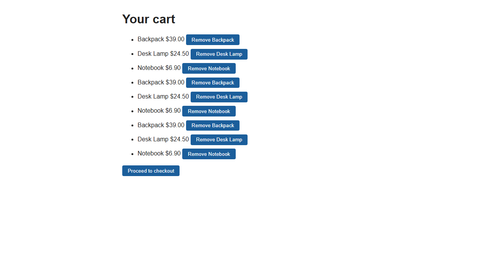

# AITAF test run report

## Summary

Tests: 54 (30 passed, 24 failed, 0 error, 0 skipped)

Run 8f9a11fc774142b683d80014029a8117 on playwright headless, python 3.12.10, Windows 11, workers 1, timeout 5000 ms, retries 0, healing on; generated 2026-11-16 04:16 UTC.

Provider: mock

## Metrics

| Metric | Value | Basis |
|---|---|---|
| Pass rate | 55.6% | passed tests over executed tests (skipped tests excluded) |
| Requirement coverage | 90.0% | requirements with at least one approved test case over all requirements |
| Script executability | 100.0% | scripts whose test ran to a pass or a fail (no error) over scripts generated |
| Healing success rate | 5.0% | steps with a proposed locator over steps that asked for healing |
| Classification accuracy | n/a | failures whose category equals the supplied label over labelled failures |
| Generation latency (median) | 773 ms | analyze and generate steps of the three generation components, LLM time included |
| LLM call latency (median) | 2 ms | gateway calls to the provider (mock or live, see the provider label) |
| Non-LLM latency (p95) | n/a | report rendering samples, nearest-rank 95th percentile |
| API cost | $0.0000 | sum of token costs of the runs involved (zero for the mock provider) |
| API cost per run | $0.0000 | API cost divided by the 2 run(s) involved |

## Results

| Test case | Title | Requirement | Status | Duration | Attempts | Healed | Failure category |
|---|---|---|---|---|---|---|---|
| TC-019BAFBA-01 | Verify that a system can allow a registered customer to log in with an email address and a password | REQ-019BAFBA | PASSED | 302 ms | 1 | no | - |
| TC-019BAFBA-02 | Reject invalid input when a system tries to allow a registered customer to log in with an email address and a password | REQ-019BAFBA | PASSED | 235 ms | 1 | no | - |
| TC-019BAFBA-03 | Check boundary values when a system tries to allow a registered customer to log in with an email address and a password | REQ-019BAFBA | PASSED | 181 ms | 1 | no | - |
| TC-1542276C-01 | Verify that a system can provide a link back to the product list on the confirmation page | REQ-1542276C | PASSED | 516 ms | 1 | no | - |
| TC-1542276C-02 | Reject invalid input when a system tries to provide a link back to the product list on the confirmation page | REQ-1542276C | PASSED | 563 ms | 1 | no | - |
| TC-1542276C-03 | Check boundary values when a system tries to provide a link back to the product list on the confirmation page | REQ-1542276C | PASSED | 504 ms | 1 | no | - |
| TC-1C7A3D37-01 | Verify that a system can refuse an order when the cart is empty | REQ-1C7A3D37 | FAILED | 270 ms | 1 | no | locator |
| TC-1C7A3D37-02 | Reject invalid input when a system tries to refuse an order when the cart is empty | REQ-1C7A3D37 | FAILED | 255 ms | 1 | no | locator |
| TC-1C7A3D37-03 | Check boundary values when a system tries to refuse an order when the cart is empty | REQ-1C7A3D37 | FAILED | 253 ms | 1 | no | locator |
| TC-215A6FB0-01 | Verify that a user can The product list shall contain an add button for every product | REQ-215A6FB0 | PASSED | 568 ms | 2 | yes | - |
| TC-215A6FB0-02 | Reject invalid input when a user tries to The product list shall contain an add button for every product | REQ-215A6FB0 | PASSED | 549 ms | 2 | no | - |
| TC-215A6FB0-03 | Check boundary values when a user tries to The product list shall contain an add button for every product | REQ-215A6FB0 | PASSED | 404 ms | 2 | no | - |
| TC-36E92D70-01 | Verify that a system can not show the product list, the cart or the checkout page to a visitor who is not logged in | REQ-36E92D70 | FAILED | 265 ms | 1 | no | locator |
| TC-36E92D70-02 | Reject invalid input when a system tries to not show the product list, the cart or the checkout page to a visitor who is not logged in | REQ-36E92D70 | FAILED | 244 ms | 1 | no | locator |
| TC-36E92D70-03 | Check boundary values when a system tries to not show the product list, the cart or the checkout page to a visitor who is not logged in | REQ-36E92D70 | FAILED | 256 ms | 1 | no | locator |
| TC-3779D5EE-01 | Verify that a system can provide a checkout button in a cart that holds at least one product | REQ-3779D5EE | FAILED | 267 ms | 1 | no | locator |
| TC-3779D5EE-02 | Reject invalid input when a system tries to provide a checkout button in a cart that holds at least one product | REQ-3779D5EE | FAILED | 263 ms | 1 | no | locator |
| TC-3779D5EE-03 | Check boundary values when a system tries to provide a checkout button in a cart that holds at least one product | REQ-3779D5EE | FAILED | 250 ms | 1 | no | locator |
| TC-458CCB5E-01 | Verify that a system can require a full name before an order can be placed | REQ-458CCB5E | PASSED | 486 ms | 1 | no | - |
| TC-458CCB5E-02 | Reject invalid input when a system tries to require a full name before an order can be placed | REQ-458CCB5E | PASSED | 511 ms | 1 | no | - |
| TC-458CCB5E-03 | Check boundary values when a system tries to require a full name before an order can be placed | REQ-458CCB5E | PASSED | 512 ms | 1 | no | - |
| TC-4C589A83-01 | Verify that a system can refuse a request to add a product that is not in the catalogue | REQ-4C589A83 | PASSED | 423 ms | 2 | no | - |
| TC-4C589A83-02 | Reject invalid input when a system tries to refuse a request to add a product that is not in the catalogue | REQ-4C589A83 | PASSED | 443 ms | 2 | no | - |
| TC-4C589A83-03 | Check boundary values when a system tries to refuse a request to add a product that is not in the catalogue | REQ-4C589A83 | PASSED | 402 ms | 2 | no | - |
| TC-550347EC-01 | Verify that a system can empty the cart after an order is placed | REQ-550347EC | FAILED | 243 ms | 1 | no | locator |
| TC-550347EC-02 | Reject invalid input when a system tries to empty the cart after an order is placed | REQ-550347EC | FAILED | 242 ms | 1 | no | locator |
| TC-550347EC-03 | Check boundary values when a system tries to empty the cart after an order is placed | REQ-550347EC | FAILED | 255 ms | 1 | no | locator |
| TC-5B2846AE-01 | Verify that a system can show the message "Your cart is empty" when the cart holds no products | REQ-5B2846AE | FAILED | 259 ms | 1 | no | locator |
| TC-5B2846AE-02 | Reject invalid input when a system tries to show the message "Your cart is empty" when the cart holds no products | REQ-5B2846AE | FAILED | 245 ms | 1 | no | locator |
| TC-5B2846AE-03 | Check boundary values when a system tries to show the message "Your cart is empty" when the cart holds no products | REQ-5B2846AE | FAILED | 240 ms | 1 | no | locator |
| TC-786DC9DA-01 | Verify that a system can refuse an order when the full name is longer than 80 characters | REQ-786DC9DA | PASSED | 491 ms | 1 | no | - |
| TC-786DC9DA-02 | Reject invalid input when a system tries to refuse an order when the full name is longer than 80 characters | REQ-786DC9DA | PASSED | 462 ms | 1 | no | - |
| TC-786DC9DA-03 | Check boundary values when a system tries to refuse an order when the full name is longer than 80 characters | REQ-786DC9DA | PASSED | 501 ms | 1 | no | - |
| TC-9881818E-01 | Verify that a system can show the message "Invalid email or password" and keep the product list closed when the credentials are wrong | REQ-9881818E | PASSED | 80 ms | 1 | no | - |
| TC-9881818E-02 | Reject invalid input when a system tries to show the message "Invalid email or password" and keep the product list closed when the credentials are wrong | REQ-9881818E | PASSED | 79 ms | 1 | no | - |
| TC-9881818E-03 | Check boundary values when a system tries to show the message "Invalid email or password" and keep the product list closed when the credentials are wrong | REQ-9881818E | PASSED | 81 ms | 1 | no | - |
| TC-AB096D5B-01 | Verify that a system can show each product in the cart with its name and price | REQ-AB096D5B | FAILED | 264 ms | 1 | no | locator |
| TC-AB096D5B-02 | Reject invalid input when a system tries to show each product in the cart with its name and price | REQ-AB096D5B | FAILED | 260 ms | 1 | no | locator |
| TC-AB096D5B-03 | Check boundary values when a system tries to show each product in the cart with its name and price | REQ-AB096D5B | FAILED | 295 ms | 1 | no | locator |
| TC-B63F4FBB-01 | Verify that a system can add a product to the cart when the customer selects its add button | REQ-B63F4FBB | FAILED | 275 ms | 1 | no | locator |
| TC-B63F4FBB-02 | Reject invalid input when a system tries to add a product to the cart when the customer selects its add button | REQ-B63F4FBB | FAILED | 238 ms | 1 | no | locator |
| TC-B63F4FBB-03 | Check boundary values when a system tries to add a product to the cart when the customer selects its add button | REQ-B63F4FBB | FAILED | 252 ms | 1 | no | locator |
| TC-BB99F1B7-01 | Verify that a system can show a product list in which every product has a name and a price in dollars | REQ-BB99F1B7 | PASSED | 407 ms | 1 | no | - |
| TC-BB99F1B7-02 | Reject invalid input when a system tries to show a product list in which every product has a name and a price in dollars | REQ-BB99F1B7 | PASSED | 413 ms | 1 | no | - |
| TC-BB99F1B7-03 | Check boundary values when a system tries to show a product list in which every product has a name and a price in dollars | REQ-BB99F1B7 | PASSED | 418 ms | 1 | no | - |
| TC-C3BFFA7E-01 | Verify that a system can show a confirmation message after a successful order | REQ-C3BFFA7E | PASSED | 486 ms | 1 | no | - |
| TC-C3BFFA7E-02 | Reject invalid input when a system tries to show a confirmation message after a successful order | REQ-C3BFFA7E | PASSED | 488 ms | 1 | no | - |
| TC-C3BFFA7E-03 | Check boundary values when a system tries to show a confirmation message after a successful order | REQ-C3BFFA7E | PASSED | 535 ms | 1 | no | - |
| TC-D2433ADB-01 | Verify that a system can remove a product from the cart when the customer selects its remove button | REQ-D2433ADB | FAILED | 250 ms | 1 | no | locator |
| TC-D2433ADB-02 | Reject invalid input when a system tries to remove a product from the cart when the customer selects its remove button | REQ-D2433ADB | FAILED | 244 ms | 1 | no | locator |
| TC-D2433ADB-03 | Check boundary values when a system tries to remove a product from the cart when the customer selects its remove button | REQ-D2433ADB | FAILED | 261 ms | 1 | no | locator |
| TC-E95ED90D-01 | Verify that a system can show exactly three products: Backpack, Desk Lamp and Notebook | REQ-E95ED90D | PASSED | 416 ms | 2 | no | - |
| TC-E95ED90D-02 | Reject invalid input when a system tries to show exactly three products: Backpack, Desk Lamp and Notebook | REQ-E95ED90D | PASSED | 409 ms | 2 | no | - |
| TC-E95ED90D-03 | Check boundary values when a system tries to show exactly three products: Backpack, Desk Lamp and Notebook | REQ-E95ED90D | PASSED | 424 ms | 2 | no | - |

## Failure analysis

### TC-1C7A3D37-01: locator

Confidence 0.90 (rules); cluster CL-95c25919.

- Cause: The element 'add_backpack' on page 'shop' was not found: the stored locator no longer matches the page. Self-healing was attempted (2 event(s): no_candidate, no_candidate).
- Next step: Run with --heal and review the proposed locator, or update the locator in the page object; if the element was removed on purpose, update the test.
- Evidence: log:4267737973c0461896e2ef8ffcb8774b, screenshot:tests_test_tc_1c7a3d37_01.py_test_tc_1c7a3d37_01.a1.png, dom:tests_test_tc_1c7a3d37_01.py_test_tc_1c7a3d37_01.a1.html, healing:2443a451244e4c27b0d3dbae5e3325ce, healing:04df7e5c0b524c45b52b70cd7b4596cb


```text
_ _ _ _ _ _ _ _ _ _ _ _ _ _ _ _ _ _ _ _ _ _ _ _ _ _ _ _ _ _ _ _ _ _ _ _
pages\shop_page.py:38: in click
    self._find(name).click()
    ^^^^^^^^^^^^^^^^
_ _ _ _ _ _ _ _ _ _ _ _ _ _ _ _ _ _ _ _ _ _ _ _ _ _ _ _ _ _ _ _ _ _ _ _ _ _ _ _

self = <pages.shop_page.ShopPage object at 0x00000231474A6450>
name = 'add_backpack'

    def _find(self, name):
        entry = LOCATORS[name]
        for strategy, value in [entry["primary"], *entry["fallbacks"]]:
            candidate = self._page.locator(_selector(strategy, value))
            if candidate.count() > 0:
                return candidate.first
>       raise LookupError("no locator strategy matched for " + name + " on page shop")
E       LookupError: no locator strategy matched for add_backpack on page shop

pages\shop_page.py:35: LookupError
```

[page snapshot](evidence/tests_test_tc_1c7a3d37_01.py_test_tc_1c7a3d37_01.a1.html) | [log](logs/4267737973c0461896e2ef8ffcb8774b.txt)

### TC-1C7A3D37-02: locator

Confidence 0.90 (rules); cluster CL-95c25919.

- Cause: The element 'add_backpack' on page 'shop' was not found: the stored locator no longer matches the page. Self-healing was attempted (2 event(s): no_candidate, no_candidate).
- Next step: Run with --heal and review the proposed locator, or update the locator in the page object; if the element was removed on purpose, update the test.
- Evidence: log:5b9c6d2aa34d4bb29e658744015651e7, screenshot:tests_test_tc_1c7a3d37_02.py_test_tc_1c7a3d37_02.a1.png, dom:tests_test_tc_1c7a3d37_02.py_test_tc_1c7a3d37_02.a1.html, healing:a40ad9dfd1a94dbba2552f2261da3650, healing:15242a54de6d4db1b1d92665c62826a9


```text
_ _ _ _ _ _ _ _ _ _ _ _ _ _ _ _ _ _ _ _ _ _ _ _ _ _ _ _ _ _ _ _ _ _ _ _
pages\shop_page.py:38: in click
    self._find(name).click()
    ^^^^^^^^^^^^^^^^
_ _ _ _ _ _ _ _ _ _ _ _ _ _ _ _ _ _ _ _ _ _ _ _ _ _ _ _ _ _ _ _ _ _ _ _ _ _ _ _

self = <pages.shop_page.ShopPage object at 0x0000023147346C60>
name = 'add_backpack'

    def _find(self, name):
        entry = LOCATORS[name]
        for strategy, value in [entry["primary"], *entry["fallbacks"]]:
            candidate = self._page.locator(_selector(strategy, value))
            if candidate.count() > 0:
                return candidate.first
>       raise LookupError("no locator strategy matched for " + name + " on page shop")
E       LookupError: no locator strategy matched for add_backpack on page shop

pages\shop_page.py:35: LookupError
```

[page snapshot](evidence/tests_test_tc_1c7a3d37_02.py_test_tc_1c7a3d37_02.a1.html) | [log](logs/5b9c6d2aa34d4bb29e658744015651e7.txt)

### TC-1C7A3D37-03: locator

Confidence 0.90 (rules); cluster CL-95c25919.

- Cause: The element 'add_backpack' on page 'shop' was not found: the stored locator no longer matches the page. Self-healing was attempted (2 event(s): no_candidate, no_candidate).
- Next step: Run with --heal and review the proposed locator, or update the locator in the page object; if the element was removed on purpose, update the test.
- Evidence: log:cb65081a95fd4ad0bc29787c01a76e00, screenshot:tests_test_tc_1c7a3d37_03.py_test_tc_1c7a3d37_03.a1.png, dom:tests_test_tc_1c7a3d37_03.py_test_tc_1c7a3d37_03.a1.html, healing:1851d7c547f5410791595c3ce3380159, healing:0f3be9f2bcbb4d38850dd1dd9583c81c


```text
_ _ _ _ _ _ _ _ _ _ _ _ _ _ _ _ _ _ _ _ _ _ _ _ _ _ _ _ _ _ _ _ _ _ _ _
pages\shop_page.py:38: in click
    self._find(name).click()
    ^^^^^^^^^^^^^^^^
_ _ _ _ _ _ _ _ _ _ _ _ _ _ _ _ _ _ _ _ _ _ _ _ _ _ _ _ _ _ _ _ _ _ _ _ _ _ _ _

self = <pages.shop_page.ShopPage object at 0x0000023147526030>
name = 'add_backpack'

    def _find(self, name):
        entry = LOCATORS[name]
        for strategy, value in [entry["primary"], *entry["fallbacks"]]:
            candidate = self._page.locator(_selector(strategy, value))
            if candidate.count() > 0:
                return candidate.first
>       raise LookupError("no locator strategy matched for " + name + " on page shop")
E       LookupError: no locator strategy matched for add_backpack on page shop

pages\shop_page.py:35: LookupError
```

[page snapshot](evidence/tests_test_tc_1c7a3d37_03.py_test_tc_1c7a3d37_03.a1.html) | [log](logs/cb65081a95fd4ad0bc29787c01a76e00.txt)

### TC-36E92D70-01: locator

Confidence 0.90 (rules); cluster CL-95c25919.

- Cause: The element 'add_backpack' on page 'shop' was not found: the stored locator no longer matches the page. Self-healing was attempted (4 event(s): no_candidate, rejected, rejected, rejected).
- Next step: Run with --heal and review the proposed locator, or update the locator in the page object; if the element was removed on purpose, update the test.
- Evidence: log:4f78bf529e444ac589b20af396a7b25a, screenshot:tests_test_tc_36e92d70_01.py_test_tc_36e92d70_01.a1.png, dom:tests_test_tc_36e92d70_01.py_test_tc_36e92d70_01.a1.html, healing:76fe8ad3b92e4d60b1572173c953c86a, healing:607136502e2c422a84cb977421cb3f62, healing:6f716e4f182046deb9a9e8db17a4a7d3, healing:7e10a1a3639741a6939593859941e0d6


```text
_ _ _ _ _ _ _ _ _ _ _ _ _ _ _ _ _ _ _ _ _ _ _ _ _ _ _ _ _ _ _ _ _ _ _ _
pages\shop_page.py:38: in click
    self._find(name).click()
    ^^^^^^^^^^^^^^^^
_ _ _ _ _ _ _ _ _ _ _ _ _ _ _ _ _ _ _ _ _ _ _ _ _ _ _ _ _ _ _ _ _ _ _ _ _ _ _ _

self = <pages.shop_page.ShopPage object at 0x0000023147524650>
name = 'add_backpack'

    def _find(self, name):
        entry = LOCATORS[name]
        for strategy, value in [entry["primary"], *entry["fallbacks"]]:
            candidate = self._page.locator(_selector(strategy, value))
            if candidate.count() > 0:
                return candidate.first
>       raise LookupError("no locator strategy matched for " + name + " on page shop")
E       LookupError: no locator strategy matched for add_backpack on page shop

pages\shop_page.py:35: LookupError
```

[page snapshot](evidence/tests_test_tc_36e92d70_01.py_test_tc_36e92d70_01.a1.html) | [log](logs/4f78bf529e444ac589b20af396a7b25a.txt)

### TC-36E92D70-02: locator

Confidence 0.90 (rules); cluster CL-95c25919.

- Cause: The element 'add_backpack' on page 'shop' was not found: the stored locator no longer matches the page. Self-healing was attempted (4 event(s): no_candidate, rejected, rejected, rejected).
- Next step: Run with --heal and review the proposed locator, or update the locator in the page object; if the element was removed on purpose, update the test.
- Evidence: log:68a73ea02cc34b04a2ac3c088f61cc89, screenshot:tests_test_tc_36e92d70_02.py_test_tc_36e92d70_02.a1.png, dom:tests_test_tc_36e92d70_02.py_test_tc_36e92d70_02.a1.html, healing:d6c24da8d3494c63b546b6a4edef0adb, healing:92d947b93f1c417fa881fb19277e1222, healing:66ededfd883c44979dec0499cbab487c, healing:d67bf96cbb9b4a9fb715dcd5415c2ac7


```text
_ _ _ _ _ _ _ _ _ _ _ _ _ _ _ _ _ _ _ _ _ _ _ _ _ _ _ _ _ _ _ _ _ _ _ _
pages\shop_page.py:38: in click
    self._find(name).click()
    ^^^^^^^^^^^^^^^^
_ _ _ _ _ _ _ _ _ _ _ _ _ _ _ _ _ _ _ _ _ _ _ _ _ _ _ _ _ _ _ _ _ _ _ _ _ _ _ _

self = <pages.shop_page.ShopPage object at 0x0000023147346E10>
name = 'add_backpack'

    def _find(self, name):
        entry = LOCATORS[name]
        for strategy, value in [entry["primary"], *entry["fallbacks"]]:
            candidate = self._page.locator(_selector(strategy, value))
            if candidate.count() > 0:
                return candidate.first
>       raise LookupError("no locator strategy matched for " + name + " on page shop")
E       LookupError: no locator strategy matched for add_backpack on page shop

pages\shop_page.py:35: LookupError
```

[page snapshot](evidence/tests_test_tc_36e92d70_02.py_test_tc_36e92d70_02.a1.html) | [log](logs/68a73ea02cc34b04a2ac3c088f61cc89.txt)

### TC-36E92D70-03: locator

Confidence 0.90 (rules); cluster CL-95c25919.

- Cause: The element 'add_backpack' on page 'shop' was not found: the stored locator no longer matches the page. Self-healing was attempted (4 event(s): no_candidate, rejected, rejected, rejected).
- Next step: Run with --heal and review the proposed locator, or update the locator in the page object; if the element was removed on purpose, update the test.
- Evidence: log:8e57a18ce3d44edbad402b3c23652f40, screenshot:tests_test_tc_36e92d70_03.py_test_tc_36e92d70_03.a1.png, dom:tests_test_tc_36e92d70_03.py_test_tc_36e92d70_03.a1.html, healing:894aa11a538d4a29a34475311ddfcbe3, healing:814690ecbc0d41e281a8c7eaf2132394, healing:c3746943d0bd4b6e97d919078b2276db, healing:8f7c99a683824e2d8df064c7d1bd13e3


```text
_ _ _ _ _ _ _ _ _ _ _ _ _ _ _ _ _ _ _ _ _ _ _ _ _ _ _ _ _ _ _ _ _ _ _ _
pages\shop_page.py:38: in click
    self._find(name).click()
    ^^^^^^^^^^^^^^^^
_ _ _ _ _ _ _ _ _ _ _ _ _ _ _ _ _ _ _ _ _ _ _ _ _ _ _ _ _ _ _ _ _ _ _ _ _ _ _ _

self = <pages.shop_page.ShopPage object at 0x000002314736FD40>
name = 'add_backpack'

    def _find(self, name):
        entry = LOCATORS[name]
        for strategy, value in [entry["primary"], *entry["fallbacks"]]:
            candidate = self._page.locator(_selector(strategy, value))
            if candidate.count() > 0:
                return candidate.first
>       raise LookupError("no locator strategy matched for " + name + " on page shop")
E       LookupError: no locator strategy matched for add_backpack on page shop

pages\shop_page.py:35: LookupError
```

[page snapshot](evidence/tests_test_tc_36e92d70_03.py_test_tc_36e92d70_03.a1.html) | [log](logs/8e57a18ce3d44edbad402b3c23652f40.txt)

### TC-3779D5EE-01: locator

Confidence 0.90 (rules); cluster CL-95c25919.

- Cause: The element 'add_backpack' on page 'shop' was not found: the stored locator no longer matches the page. Self-healing was attempted (4 event(s): no_candidate, rejected, rejected, rejected).
- Next step: Run with --heal and review the proposed locator, or update the locator in the page object; if the element was removed on purpose, update the test.
- Evidence: log:634598cbad67493e99d1f1d5e04444db, screenshot:tests_test_tc_3779d5ee_01.py_test_tc_3779d5ee_01.a1.png, dom:tests_test_tc_3779d5ee_01.py_test_tc_3779d5ee_01.a1.html, healing:a24cf618d89343d794c40061d29cb37e, healing:6904d37d34d44dfc86dbc07d1154b5dd, healing:1eb7938a88cd4a85a92fb4e403fa870d, healing:1065e6072273465e82c587655fbc7460


```text
_ _ _ _ _ _ _ _ _ _ _ _ _ _ _ _ _ _ _ _ _ _ _ _ _ _ _ _ _ _ _ _ _ _ _ _
pages\shop_page.py:38: in click
    self._find(name).click()
    ^^^^^^^^^^^^^^^^
_ _ _ _ _ _ _ _ _ _ _ _ _ _ _ _ _ _ _ _ _ _ _ _ _ _ _ _ _ _ _ _ _ _ _ _ _ _ _ _

self = <pages.shop_page.ShopPage object at 0x000002314760CBC0>
name = 'add_backpack'

    def _find(self, name):
        entry = LOCATORS[name]
        for strategy, value in [entry["primary"], *entry["fallbacks"]]:
            candidate = self._page.locator(_selector(strategy, value))
            if candidate.count() > 0:
                return candidate.first
>       raise LookupError("no locator strategy matched for " + name + " on page shop")
E       LookupError: no locator strategy matched for add_backpack on page shop

pages\shop_page.py:35: LookupError
```

[page snapshot](evidence/tests_test_tc_3779d5ee_01.py_test_tc_3779d5ee_01.a1.html) | [log](logs/634598cbad67493e99d1f1d5e04444db.txt)

### TC-3779D5EE-02: locator

Confidence 0.90 (rules); cluster CL-95c25919.

- Cause: The element 'add_backpack' on page 'shop' was not found: the stored locator no longer matches the page. Self-healing was attempted (4 event(s): no_candidate, rejected, rejected, rejected).
- Next step: Run with --heal and review the proposed locator, or update the locator in the page object; if the element was removed on purpose, update the test.
- Evidence: log:5ca1e27f936b41b1a11a781822c7925d, screenshot:tests_test_tc_3779d5ee_02.py_test_tc_3779d5ee_02.a1.png, dom:tests_test_tc_3779d5ee_02.py_test_tc_3779d5ee_02.a1.html, healing:1d0d8985a18143ba877e347ce3641e5e, healing:5977552fe7b04b50a92d08eda4a89c8e, healing:c231f7807cf14b2e9138f8e2f635560f, healing:8ddf231301b54932a9e8baa76e2949ca


```text
_ _ _ _ _ _ _ _ _ _ _ _ _ _ _ _ _ _ _ _ _ _ _ _ _ _ _ _ _ _ _ _ _ _ _ _
pages\shop_page.py:38: in click
    self._find(name).click()
    ^^^^^^^^^^^^^^^^
_ _ _ _ _ _ _ _ _ _ _ _ _ _ _ _ _ _ _ _ _ _ _ _ _ _ _ _ _ _ _ _ _ _ _ _ _ _ _ _

self = <pages.shop_page.ShopPage object at 0x0000023147799700>
name = 'add_backpack'

    def _find(self, name):
        entry = LOCATORS[name]
        for strategy, value in [entry["primary"], *entry["fallbacks"]]:
            candidate = self._page.locator(_selector(strategy, value))
            if candidate.count() > 0:
                return candidate.first
>       raise LookupError("no locator strategy matched for " + name + " on page shop")
E       LookupError: no locator strategy matched for add_backpack on page shop

pages\shop_page.py:35: LookupError
```

[page snapshot](evidence/tests_test_tc_3779d5ee_02.py_test_tc_3779d5ee_02.a1.html) | [log](logs/5ca1e27f936b41b1a11a781822c7925d.txt)

### TC-3779D5EE-03: locator

Confidence 0.90 (rules); cluster CL-95c25919.

- Cause: The element 'add_backpack' on page 'shop' was not found: the stored locator no longer matches the page. Self-healing was attempted (4 event(s): no_candidate, rejected, rejected, rejected).
- Next step: Run with --heal and review the proposed locator, or update the locator in the page object; if the element was removed on purpose, update the test.
- Evidence: log:a5d182d7f22f41bdaf2629b203a8e497, screenshot:tests_test_tc_3779d5ee_03.py_test_tc_3779d5ee_03.a1.png, dom:tests_test_tc_3779d5ee_03.py_test_tc_3779d5ee_03.a1.html, healing:98c9f5498a77479b969cfa51776962a2, healing:2a2b2b2586a6473fbe628dd613b26ad7, healing:f2c42f572ede4856a5a79102b65061b8, healing:5af1b13b8fb447f0a040c6651c8d4322


```text
_ _ _ _ _ _ _ _ _ _ _ _ _ _ _ _ _ _ _ _ _ _ _ _ _ _ _ _ _ _ _ _ _ _ _ _
pages\shop_page.py:38: in click
    self._find(name).click()
    ^^^^^^^^^^^^^^^^
_ _ _ _ _ _ _ _ _ _ _ _ _ _ _ _ _ _ _ _ _ _ _ _ _ _ _ _ _ _ _ _ _ _ _ _ _ _ _ _

self = <pages.shop_page.ShopPage object at 0x00000231475A9C10>
name = 'add_backpack'

    def _find(self, name):
        entry = LOCATORS[name]
        for strategy, value in [entry["primary"], *entry["fallbacks"]]:
            candidate = self._page.locator(_selector(strategy, value))
            if candidate.count() > 0:
                return candidate.first
>       raise LookupError("no locator strategy matched for " + name + " on page shop")
E       LookupError: no locator strategy matched for add_backpack on page shop

pages\shop_page.py:35: LookupError
```

[page snapshot](evidence/tests_test_tc_3779d5ee_03.py_test_tc_3779d5ee_03.a1.html) | [log](logs/a5d182d7f22f41bdaf2629b203a8e497.txt)

### TC-550347EC-01: locator

Confidence 0.90 (rules); cluster CL-95c25919.

- Cause: The element 'add_backpack' on page 'shop' was not found: the stored locator no longer matches the page. Self-healing was attempted (4 event(s): no_candidate, rejected, rejected, rejected).
- Next step: Run with --heal and review the proposed locator, or update the locator in the page object; if the element was removed on purpose, update the test.
- Evidence: log:48b795897e644d178726c4addb5ebe8e, screenshot:tests_test_tc_550347ec_01.py_test_tc_550347ec_01.a1.png, dom:tests_test_tc_550347ec_01.py_test_tc_550347ec_01.a1.html, healing:f1997eb723b448c899e65bb23eb67c30, healing:e1dffc08a2464d0bbefa2b9b3592cd29, healing:8a1cb1662e2c4258b7a3cb5e797bd903, healing:002ab36b8df7495eaf2a3bc16d151cae


```text
_ _ _ _ _ _ _ _ _ _ _ _ _ _ _ _ _ _ _ _ _ _ _ _ _ _ _ _ _ _ _ _ _ _ _ _
pages\shop_page.py:38: in click
    self._find(name).click()
    ^^^^^^^^^^^^^^^^
_ _ _ _ _ _ _ _ _ _ _ _ _ _ _ _ _ _ _ _ _ _ _ _ _ _ _ _ _ _ _ _ _ _ _ _ _ _ _ _

self = <pages.shop_page.ShopPage object at 0x00000231475A9C70>
name = 'add_backpack'

    def _find(self, name):
        entry = LOCATORS[name]
        for strategy, value in [entry["primary"], *entry["fallbacks"]]:
            candidate = self._page.locator(_selector(strategy, value))
            if candidate.count() > 0:
                return candidate.first
>       raise LookupError("no locator strategy matched for " + name + " on page shop")
E       LookupError: no locator strategy matched for add_backpack on page shop

pages\shop_page.py:35: LookupError
```

[page snapshot](evidence/tests_test_tc_550347ec_01.py_test_tc_550347ec_01.a1.html) | [log](logs/48b795897e644d178726c4addb5ebe8e.txt)

### TC-550347EC-02: locator

Confidence 0.90 (rules); cluster CL-95c25919.

- Cause: The element 'add_backpack' on page 'shop' was not found: the stored locator no longer matches the page. Self-healing was attempted (4 event(s): no_candidate, rejected, rejected, rejected).
- Next step: Run with --heal and review the proposed locator, or update the locator in the page object; if the element was removed on purpose, update the test.
- Evidence: log:2514e67ff21b46949cb2c3badd2fe1f3, screenshot:tests_test_tc_550347ec_02.py_test_tc_550347ec_02.a1.png, dom:tests_test_tc_550347ec_02.py_test_tc_550347ec_02.a1.html, healing:2f715f9816ed4b2cb2325fa0d62be5e3, healing:198e62d7532c457fb5ec23a569dc4536, healing:a00bebb58cdd4bfea409d7996bc8c953, healing:4e19f5b483ca4f2bb758d57b9595d6fe



```text
_ _ _ _ _ _ _ _ _ _ _ _ _ _ _ _ _ _ _ _ _ _ _ _ _ _ _ _ _ _ _ _ _ _ _ _
pages\shop_page.py:38: in click
    self._find(name).click()
    ^^^^^^^^^^^^^^^^
_ _ _ _ _ _ _ _ _ _ _ _ _ _ _ _ _ _ _ _ _ _ _ _ _ _ _ _ _ _ _ _ _ _ _ _ _ _ _ _

self = <pages.shop_page.ShopPage object at 0x000002314744F980>
name = 'add_backpack'

    def _find(self, name):
        entry = LOCATORS[name]
        for strategy, value in [entry["primary"], *entry["fallbacks"]]:
            candidate = self._page.locator(_selector(strategy, value))
            if candidate.count() > 0:
                return candidate.first
>       raise LookupError("no locator strategy matched for " + name + " on page shop")
E       LookupError: no locator strategy matched for add_backpack on page shop

pages\shop_page.py:35: LookupError
```

[page snapshot](evidence/tests_test_tc_550347ec_02.py_test_tc_550347ec_02.a1.html) | [log](logs/2514e67ff21b46949cb2c3badd2fe1f3.txt)

### TC-550347EC-03: locator

Confidence 0.90 (rules); cluster CL-95c25919.

- Cause: The element 'add_backpack' on page 'shop' was not found: the stored locator no longer matches the page. Self-healing was attempted (4 event(s): no_candidate, rejected, rejected, rejected).
- Next step: Run with --heal and review the proposed locator, or update the locator in the page object; if the element was removed on purpose, update the test.
- Evidence: log:961ec3c878f640ccaa10e97162b3b375, screenshot:tests_test_tc_550347ec_03.py_test_tc_550347ec_03.a1.png, dom:tests_test_tc_550347ec_03.py_test_tc_550347ec_03.a1.html, healing:d61cea069e424457a5930a786d1d9169, healing:e48cfda4273945c0885b06cf0a54af2c, healing:6c659646ffdc476fa7c90d8cb8eeac2c, healing:4157dc5650fd47fdb6d6c06a505ec208


```text
_ _ _ _ _ _ _ _ _ _ _ _ _ _ _ _ _ _ _ _ _ _ _ _ _ _ _ _ _ _ _ _ _ _ _ _
pages\shop_page.py:38: in click
    self._find(name).click()
    ^^^^^^^^^^^^^^^^
_ _ _ _ _ _ _ _ _ _ _ _ _ _ _ _ _ _ _ _ _ _ _ _ _ _ _ _ _ _ _ _ _ _ _ _ _ _ _ _

self = <pages.shop_page.ShopPage object at 0x00000231477997F0>
name = 'add_backpack'

    def _find(self, name):
        entry = LOCATORS[name]
        for strategy, value in [entry["primary"], *entry["fallbacks"]]:
            candidate = self._page.locator(_selector(strategy, value))
            if candidate.count() > 0:
                return candidate.first
>       raise LookupError("no locator strategy matched for " + name + " on page shop")
E       LookupError: no locator strategy matched for add_backpack on page shop

pages\shop_page.py:35: LookupError
```

[page snapshot](evidence/tests_test_tc_550347ec_03.py_test_tc_550347ec_03.a1.html) | [log](logs/961ec3c878f640ccaa10e97162b3b375.txt)

### TC-5B2846AE-01: locator

Confidence 0.90 (rules); cluster CL-95c25919.

- Cause: The element 'add_backpack' on page 'shop' was not found: the stored locator no longer matches the page. Self-healing was attempted (4 event(s): no_candidate, rejected, rejected, rejected).
- Next step: Run with --heal and review the proposed locator, or update the locator in the page object; if the element was removed on purpose, update the test.
- Evidence: log:b0db9abf39214036b98d774be5dcf013, screenshot:tests_test_tc_5b2846ae_01.py_test_tc_5b2846ae_01.a1.png, dom:tests_test_tc_5b2846ae_01.py_test_tc_5b2846ae_01.a1.html, healing:a5433a54e7614696bd3c90af7c4af8df, healing:d908cf01e076474587767ff1fa940b0d, healing:8f0959c38d5b425ea58e4487ff2a58c5, healing:c7421e92948d46c4916ee199e3f97052


```text
_ _ _ _ _ _ _ _ _ _ _ _ _ _ _ _ _ _ _ _ _ _ _ _ _ _ _ _ _ _ _ _ _ _ _ _
pages\shop_page.py:38: in click
    self._find(name).click()
    ^^^^^^^^^^^^^^^^
_ _ _ _ _ _ _ _ _ _ _ _ _ _ _ _ _ _ _ _ _ _ _ _ _ _ _ _ _ _ _ _ _ _ _ _ _ _ _ _

self = <pages.shop_page.ShopPage object at 0x00000231474A6ED0>
name = 'add_backpack'

    def _find(self, name):
        entry = LOCATORS[name]
        for strategy, value in [entry["primary"], *entry["fallbacks"]]:
            candidate = self._page.locator(_selector(strategy, value))
            if candidate.count() > 0:
                return candidate.first
>       raise LookupError("no locator strategy matched for " + name + " on page shop")
E       LookupError: no locator strategy matched for add_backpack on page shop

pages\shop_page.py:35: LookupError
```

[page snapshot](evidence/tests_test_tc_5b2846ae_01.py_test_tc_5b2846ae_01.a1.html) | [log](logs/b0db9abf39214036b98d774be5dcf013.txt)

### TC-5B2846AE-02: locator

Confidence 0.90 (rules); cluster CL-95c25919.

- Cause: The element 'add_backpack' on page 'shop' was not found: the stored locator no longer matches the page. Self-healing was attempted (4 event(s): no_candidate, rejected, rejected, rejected).
- Next step: Run with --heal and review the proposed locator, or update the locator in the page object; if the element was removed on purpose, update the test.
- Evidence: log:f24b3d321c724efd8cf77e7a5f01f677, screenshot:tests_test_tc_5b2846ae_02.py_test_tc_5b2846ae_02.a1.png, dom:tests_test_tc_5b2846ae_02.py_test_tc_5b2846ae_02.a1.html, healing:211154ea828544dab24dcdef83ad9633, healing:a8de4c7e09504392abd69e18f54cf976, healing:33e0f922b9b14d338606e6ec8747c917, healing:0acb48f1072544a696cd2fd842ec4ff5


```text
_ _ _ _ _ _ _ _ _ _ _ _ _ _ _ _ _ _ _ _ _ _ _ _ _ _ _ _ _ _ _ _ _ _ _ _
pages\shop_page.py:38: in click
    self._find(name).click()
    ^^^^^^^^^^^^^^^^
_ _ _ _ _ _ _ _ _ _ _ _ _ _ _ _ _ _ _ _ _ _ _ _ _ _ _ _ _ _ _ _ _ _ _ _ _ _ _ _

self = <pages.shop_page.ShopPage object at 0x000002314760C3B0>
name = 'add_backpack'

    def _find(self, name):
        entry = LOCATORS[name]
        for strategy, value in [entry["primary"], *entry["fallbacks"]]:
            candidate = self._page.locator(_selector(strategy, value))
            if candidate.count() > 0:
                return candidate.first
>       raise LookupError("no locator strategy matched for " + name + " on page shop")
E       LookupError: no locator strategy matched for add_backpack on page shop

pages\shop_page.py:35: LookupError
```

[page snapshot](evidence/tests_test_tc_5b2846ae_02.py_test_tc_5b2846ae_02.a1.html) | [log](logs/f24b3d321c724efd8cf77e7a5f01f677.txt)

### TC-5B2846AE-03: locator

Confidence 0.90 (rules); cluster CL-95c25919.

- Cause: The element 'add_backpack' on page 'shop' was not found: the stored locator no longer matches the page. Self-healing was attempted (4 event(s): no_candidate, rejected, rejected, rejected).
- Next step: Run with --heal and review the proposed locator, or update the locator in the page object; if the element was removed on purpose, update the test.
- Evidence: log:9b36f7f2fdba441ca0f6326b467a048c, screenshot:tests_test_tc_5b2846ae_03.py_test_tc_5b2846ae_03.a1.png, dom:tests_test_tc_5b2846ae_03.py_test_tc_5b2846ae_03.a1.html, healing:f3f1b00fc4424c389e056e703d668e27, healing:ae2538be599e4595b03fa07071d7b121, healing:0b3c1e9d1d0444f6a4a125e173c1eaa5, healing:1f71a0c4056b44249b450cc36e75adcd


```text
_ _ _ _ _ _ _ _ _ _ _ _ _ _ _ _ _ _ _ _ _ _ _ _ _ _ _ _ _ _ _ _ _ _ _ _
pages\shop_page.py:38: in click
    self._find(name).click()
    ^^^^^^^^^^^^^^^^
_ _ _ _ _ _ _ _ _ _ _ _ _ _ _ _ _ _ _ _ _ _ _ _ _ _ _ _ _ _ _ _ _ _ _ _ _ _ _ _

self = <pages.shop_page.ShopPage object at 0x00000231477C57F0>
name = 'add_backpack'

    def _find(self, name):
        entry = LOCATORS[name]
        for strategy, value in [entry["primary"], *entry["fallbacks"]]:
            candidate = self._page.locator(_selector(strategy, value))
            if candidate.count() > 0:
                return candidate.first
>       raise LookupError("no locator strategy matched for " + name + " on page shop")
E       LookupError: no locator strategy matched for add_backpack on page shop

pages\shop_page.py:35: LookupError
```

[page snapshot](evidence/tests_test_tc_5b2846ae_03.py_test_tc_5b2846ae_03.a1.html) | [log](logs/9b36f7f2fdba441ca0f6326b467a048c.txt)

### TC-AB096D5B-01: locator

Confidence 0.90 (rules); cluster CL-95c25919.

- Cause: The element 'add_backpack' on page 'shop' was not found: the stored locator no longer matches the page. Self-healing was attempted (2 event(s): no_candidate, no_candidate).
- Next step: Run with --heal and review the proposed locator, or update the locator in the page object; if the element was removed on purpose, update the test.
- Evidence: log:983f5496c9b4475aa2b5e0900ff680db, screenshot:tests_test_tc_ab096d5b_01.py_test_tc_ab096d5b_01.a1.png, dom:tests_test_tc_ab096d5b_01.py_test_tc_ab096d5b_01.a1.html, healing:98982dbc07f84c7eb5477f698ec96def, healing:ca44c93f1a8c4625b38df6f9e6967559


```text
_ _ _ _ _ _ _ _ _ _ _ _ _ _ _ _ _ _ _ _ _ _ _ _ _ _ _ _ _ _ _ _ _ _ _ _
pages\shop_page.py:38: in click
    self._find(name).click()
    ^^^^^^^^^^^^^^^^
_ _ _ _ _ _ _ _ _ _ _ _ _ _ _ _ _ _ _ _ _ _ _ _ _ _ _ _ _ _ _ _ _ _ _ _ _ _ _ _

self = <pages.shop_page.ShopPage object at 0x000002314760D4C0>
name = 'add_backpack'

    def _find(self, name):
        entry = LOCATORS[name]
        for strategy, value in [entry["primary"], *entry["fallbacks"]]:
            candidate = self._page.locator(_selector(strategy, value))
            if candidate.count() > 0:
                return candidate.first
>       raise LookupError("no locator strategy matched for " + name + " on page shop")
E       LookupError: no locator strategy matched for add_backpack on page shop

pages\shop_page.py:35: LookupError
```

[page snapshot](evidence/tests_test_tc_ab096d5b_01.py_test_tc_ab096d5b_01.a1.html) | [log](logs/983f5496c9b4475aa2b5e0900ff680db.txt)

### TC-AB096D5B-02: locator

Confidence 0.90 (rules); cluster CL-95c25919.

- Cause: The element 'add_backpack' on page 'shop' was not found: the stored locator no longer matches the page. Self-healing was attempted (2 event(s): no_candidate, no_candidate).
- Next step: Run with --heal and review the proposed locator, or update the locator in the page object; if the element was removed on purpose, update the test.
- Evidence: log:5eee6fd9c2d040878636d97db7adefa2, screenshot:tests_test_tc_ab096d5b_02.py_test_tc_ab096d5b_02.a1.png, dom:tests_test_tc_ab096d5b_02.py_test_tc_ab096d5b_02.a1.html, healing:d0f3ef2e325e408f9f4d946c188fe516, healing:58121c691b4f4b90aa49cdd0c1d27772


```text
_ _ _ _ _ _ _ _ _ _ _ _ _ _ _ _ _ _ _ _ _ _ _ _ _ _ _ _ _ _ _ _ _ _ _ _
pages\shop_page.py:38: in click
    self._find(name).click()
    ^^^^^^^^^^^^^^^^
_ _ _ _ _ _ _ _ _ _ _ _ _ _ _ _ _ _ _ _ _ _ _ _ _ _ _ _ _ _ _ _ _ _ _ _ _ _ _ _

self = <pages.shop_page.ShopPage object at 0x00000231477C5CD0>
name = 'add_backpack'

    def _find(self, name):
        entry = LOCATORS[name]
        for strategy, value in [entry["primary"], *entry["fallbacks"]]:
            candidate = self._page.locator(_selector(strategy, value))
            if candidate.count() > 0:
                return candidate.first
>       raise LookupError("no locator strategy matched for " + name + " on page shop")
E       LookupError: no locator strategy matched for add_backpack on page shop

pages\shop_page.py:35: LookupError
```

[page snapshot](evidence/tests_test_tc_ab096d5b_02.py_test_tc_ab096d5b_02.a1.html) | [log](logs/5eee6fd9c2d040878636d97db7adefa2.txt)

### TC-AB096D5B-03: locator

Confidence 0.90 (rules); cluster CL-95c25919.

- Cause: The element 'add_backpack' on page 'shop' was not found: the stored locator no longer matches the page. Self-healing was attempted (2 event(s): no_candidate, no_candidate).
- Next step: Run with --heal and review the proposed locator, or update the locator in the page object; if the element was removed on purpose, update the test.
- Evidence: log:043b82ab454341458465f18faa7a4955, screenshot:tests_test_tc_ab096d5b_03.py_test_tc_ab096d5b_03.a1.png, dom:tests_test_tc_ab096d5b_03.py_test_tc_ab096d5b_03.a1.html, healing:bb00bc99558540a58a8c9d9f5e29a37b, healing:b3b0e19403544043a2a1172b1ce05b6f


```text
_ _ _ _ _ _ _ _ _ _ _ _ _ _ _ _ _ _ _ _ _ _ _ _ _ _ _ _ _ _ _ _ _ _ _ _
pages\shop_page.py:38: in click
    self._find(name).click()
    ^^^^^^^^^^^^^^^^
_ _ _ _ _ _ _ _ _ _ _ _ _ _ _ _ _ _ _ _ _ _ _ _ _ _ _ _ _ _ _ _ _ _ _ _ _ _ _ _

self = <pages.shop_page.ShopPage object at 0x00000231473CABD0>
name = 'add_backpack'

    def _find(self, name):
        entry = LOCATORS[name]
        for strategy, value in [entry["primary"], *entry["fallbacks"]]:
            candidate = self._page.locator(_selector(strategy, value))
            if candidate.count() > 0:
                return candidate.first
>       raise LookupError("no locator strategy matched for " + name + " on page shop")
E       LookupError: no locator strategy matched for add_backpack on page shop

pages\shop_page.py:35: LookupError
```

[page snapshot](evidence/tests_test_tc_ab096d5b_03.py_test_tc_ab096d5b_03.a1.html) | [log](logs/043b82ab454341458465f18faa7a4955.txt)

### TC-B63F4FBB-01: locator

Confidence 0.90 (rules); cluster CL-95c25919.

- Cause: The element 'add_backpack' on page 'shop' was not found: the stored locator no longer matches the page. Self-healing was attempted (2 event(s): no_candidate, no_candidate).
- Next step: Run with --heal and review the proposed locator, or update the locator in the page object; if the element was removed on purpose, update the test.
- Evidence: log:9b84ba43a6164608b4fc72a3f28b11a8, screenshot:tests_test_tc_b63f4fbb_01.py_test_tc_b63f4fbb_01.a1.png, dom:tests_test_tc_b63f4fbb_01.py_test_tc_b63f4fbb_01.a1.html, healing:298455928f52416893f8d6517b425ab4, healing:938838949a484d47b37b9af23b66147b


```text
_ _ _ _ _ _ _ _ _ _ _ _ _ _ _ _ _ _ _ _ _ _ _ _ _ _ _ _ _ _ _ _ _ _ _ _
pages\shop_page.py:38: in click
    self._find(name).click()
    ^^^^^^^^^^^^^^^^
_ _ _ _ _ _ _ _ _ _ _ _ _ _ _ _ _ _ _ _ _ _ _ _ _ _ _ _ _ _ _ _ _ _ _ _ _ _ _ _

self = <pages.shop_page.ShopPage object at 0x000002314783B590>
name = 'add_backpack'

    def _find(self, name):
        entry = LOCATORS[name]
        for strategy, value in [entry["primary"], *entry["fallbacks"]]:
            candidate = self._page.locator(_selector(strategy, value))
            if candidate.count() > 0:
                return candidate.first
>       raise LookupError("no locator strategy matched for " + name + " on page shop")
E       LookupError: no locator strategy matched for add_backpack on page shop

pages\shop_page.py:35: LookupError
```

[page snapshot](evidence/tests_test_tc_b63f4fbb_01.py_test_tc_b63f4fbb_01.a1.html) | [log](logs/9b84ba43a6164608b4fc72a3f28b11a8.txt)

### TC-B63F4FBB-02: locator

Confidence 0.90 (rules); cluster CL-95c25919.

- Cause: The element 'add_backpack' on page 'shop' was not found: the stored locator no longer matches the page.
- Next step: Run with --heal and review the proposed locator, or update the locator in the page object; if the element was removed on purpose, update the test.
- Evidence: log:2173638470464e9ebb2359623e57c72d, screenshot:tests_test_tc_b63f4fbb_02.py_test_tc_b63f4fbb_02.a1.png, dom:tests_test_tc_b63f4fbb_02.py_test_tc_b63f4fbb_02.a1.html


```text
_ _ _ _ _ _ _ _ _ _ _ _ _ _ _ _ _ _ _ _ _ _ _ _ _ _ _ _ _ _ _ _ _ _ _ _
pages\shop_page.py:38: in click
    self._find(name).click()
    ^^^^^^^^^^^^^^^^
_ _ _ _ _ _ _ _ _ _ _ _ _ _ _ _ _ _ _ _ _ _ _ _ _ _ _ _ _ _ _ _ _ _ _ _ _ _ _ _

self = <pages.shop_page.ShopPage object at 0x00000231478EEC00>
name = 'add_backpack'

    def _find(self, name):
        entry = LOCATORS[name]
        for strategy, value in [entry["primary"], *entry["fallbacks"]]:
            candidate = self._page.locator(_selector(strategy, value))
            if candidate.count() > 0:
                return candidate.first
>       raise LookupError("no locator strategy matched for " + name + " on page shop")
E       LookupError: no locator strategy matched for add_backpack on page shop

pages\shop_page.py:35: LookupError
```

[page snapshot](evidence/tests_test_tc_b63f4fbb_02.py_test_tc_b63f4fbb_02.a1.html) | [log](logs/2173638470464e9ebb2359623e57c72d.txt)

### TC-B63F4FBB-03: locator

Confidence 0.90 (rules); cluster CL-95c25919.

- Cause: The element 'add_backpack' on page 'shop' was not found: the stored locator no longer matches the page.
- Next step: Run with --heal and review the proposed locator, or update the locator in the page object; if the element was removed on purpose, update the test.
- Evidence: log:5197d3a5bbcb43c5bb8bcd86cfd486e1, screenshot:tests_test_tc_b63f4fbb_03.py_test_tc_b63f4fbb_03.a1.png, dom:tests_test_tc_b63f4fbb_03.py_test_tc_b63f4fbb_03.a1.html


```text
_ _ _ _ _ _ _ _ _ _ _ _ _ _ _ _ _ _ _ _ _ _ _ _ _ _ _ _ _ _ _ _ _ _ _ _
pages\shop_page.py:38: in click
    self._find(name).click()
    ^^^^^^^^^^^^^^^^
_ _ _ _ _ _ _ _ _ _ _ _ _ _ _ _ _ _ _ _ _ _ _ _ _ _ _ _ _ _ _ _ _ _ _ _ _ _ _ _

self = <pages.shop_page.ShopPage object at 0x00000231473CB7A0>
name = 'add_backpack'

    def _find(self, name):
        entry = LOCATORS[name]
        for strategy, value in [entry["primary"], *entry["fallbacks"]]:
            candidate = self._page.locator(_selector(strategy, value))
            if candidate.count() > 0:
                return candidate.first
>       raise LookupError("no locator strategy matched for " + name + " on page shop")
E       LookupError: no locator strategy matched for add_backpack on page shop

pages\shop_page.py:35: LookupError
```

[page snapshot](evidence/tests_test_tc_b63f4fbb_03.py_test_tc_b63f4fbb_03.a1.html) | [log](logs/5197d3a5bbcb43c5bb8bcd86cfd486e1.txt)

### TC-D2433ADB-01: locator

Confidence 0.90 (rules); cluster CL-95c25919.

- Cause: The element 'add_backpack' on page 'shop' was not found: the stored locator no longer matches the page.
- Next step: Run with --heal and review the proposed locator, or update the locator in the page object; if the element was removed on purpose, update the test.
- Evidence: log:8eaf71a941f54b449d78da1d73f71b22, screenshot:tests_test_tc_d2433adb_01.py_test_tc_d2433adb_01.a1.png, dom:tests_test_tc_d2433adb_01.py_test_tc_d2433adb_01.a1.html


```text
_ _ _ _ _ _ _ _ _ _ _ _ _ _ _ _ _ _ _ _ _ _ _ _ _ _ _ _ _ _ _ _ _ _ _ _
pages\shop_page.py:38: in click
    self._find(name).click()
    ^^^^^^^^^^^^^^^^
_ _ _ _ _ _ _ _ _ _ _ _ _ _ _ _ _ _ _ _ _ _ _ _ _ _ _ _ _ _ _ _ _ _ _ _ _ _ _ _

self = <pages.shop_page.ShopPage object at 0x0000023147346630>
name = 'add_backpack'

    def _find(self, name):
        entry = LOCATORS[name]
        for strategy, value in [entry["primary"], *entry["fallbacks"]]:
            candidate = self._page.locator(_selector(strategy, value))
            if candidate.count() > 0:
                return candidate.first
>       raise LookupError("no locator strategy matched for " + name + " on page shop")
E       LookupError: no locator strategy matched for add_backpack on page shop

pages\shop_page.py:35: LookupError
```

[page snapshot](evidence/tests_test_tc_d2433adb_01.py_test_tc_d2433adb_01.a1.html) | [log](logs/8eaf71a941f54b449d78da1d73f71b22.txt)

### TC-D2433ADB-02: locator

Confidence 0.90 (rules); cluster CL-95c25919.

- Cause: The element 'add_backpack' on page 'shop' was not found: the stored locator no longer matches the page.
- Next step: Run with --heal and review the proposed locator, or update the locator in the page object; if the element was removed on purpose, update the test.
- Evidence: log:ca67cdd343ab45f993f95aa495537785, screenshot:tests_test_tc_d2433adb_02.py_test_tc_d2433adb_02.a1.png, dom:tests_test_tc_d2433adb_02.py_test_tc_d2433adb_02.a1.html


```text
_ _ _ _ _ _ _ _ _ _ _ _ _ _ _ _ _ _ _ _ _ _ _ _ _ _ _ _ _ _ _ _ _ _ _ _
pages\shop_page.py:38: in click
    self._find(name).click()
    ^^^^^^^^^^^^^^^^
_ _ _ _ _ _ _ _ _ _ _ _ _ _ _ _ _ _ _ _ _ _ _ _ _ _ _ _ _ _ _ _ _ _ _ _ _ _ _ _

self = <pages.shop_page.ShopPage object at 0x0000023147659F10>
name = 'add_backpack'

    def _find(self, name):
        entry = LOCATORS[name]
        for strategy, value in [entry["primary"], *entry["fallbacks"]]:
            candidate = self._page.locator(_selector(strategy, value))
            if candidate.count() > 0:
                return candidate.first
>       raise LookupError("no locator strategy matched for " + name + " on page shop")
E       LookupError: no locator strategy matched for add_backpack on page shop

pages\shop_page.py:35: LookupError
```

[page snapshot](evidence/tests_test_tc_d2433adb_02.py_test_tc_d2433adb_02.a1.html) | [log](logs/ca67cdd343ab45f993f95aa495537785.txt)

### TC-D2433ADB-03: locator

Confidence 0.90 (rules); cluster CL-95c25919.

- Cause: The element 'add_backpack' on page 'shop' was not found: the stored locator no longer matches the page.
- Next step: Run with --heal and review the proposed locator, or update the locator in the page object; if the element was removed on purpose, update the test.
- Evidence: log:d2af3cddac774771b43bc3e7c7e6dc07, screenshot:tests_test_tc_d2433adb_03.py_test_tc_d2433adb_03.a1.png, dom:tests_test_tc_d2433adb_03.py_test_tc_d2433adb_03.a1.html


```text
_ _ _ _ _ _ _ _ _ _ _ _ _ _ _ _ _ _ _ _ _ _ _ _ _ _ _ _ _ _ _ _ _ _ _ _
pages\shop_page.py:38: in click
    self._find(name).click()
    ^^^^^^^^^^^^^^^^
_ _ _ _ _ _ _ _ _ _ _ _ _ _ _ _ _ _ _ _ _ _ _ _ _ _ _ _ _ _ _ _ _ _ _ _ _ _ _ _

self = <pages.shop_page.ShopPage object at 0x000002314762DF70>
name = 'add_backpack'

    def _find(self, name):
        entry = LOCATORS[name]
        for strategy, value in [entry["primary"], *entry["fallbacks"]]:
            candidate = self._page.locator(_selector(strategy, value))
            if candidate.count() > 0:
                return candidate.first
>       raise LookupError("no locator strategy matched for " + name + " on page shop")
E       LookupError: no locator strategy matched for add_backpack on page shop

pages\shop_page.py:35: LookupError
```

[page snapshot](evidence/tests_test_tc_d2433adb_03.py_test_tc_d2433adb_03.a1.html) | [log](logs/d2af3cddac774771b43bc3e7c7e6dc07.txt)

## Self-healing

| Step | Method | Outcome | Confidence | Approved |
|---|---|---|---|---|
| tests/test_tc_1c7a3d37_01.py::test_tc_1c7a3d37_01#shop.add_backpack | fallback | no_candidate | 0.00 | no |
| tests/test_tc_1c7a3d37_01.py::test_tc_1c7a3d37_01#shop.add_backpack | similarity | no_candidate | 0.00 | no |
| tests/test_tc_1c7a3d37_02.py::test_tc_1c7a3d37_02#shop.add_backpack | fallback | no_candidate | 0.00 | no |
| tests/test_tc_1c7a3d37_02.py::test_tc_1c7a3d37_02#shop.add_backpack | similarity | no_candidate | 0.00 | no |
| tests/test_tc_1c7a3d37_03.py::test_tc_1c7a3d37_03#shop.add_backpack | fallback | no_candidate | 0.00 | no |
| tests/test_tc_1c7a3d37_03.py::test_tc_1c7a3d37_03#shop.add_backpack | similarity | no_candidate | 0.00 | no |
| tests/test_tc_215a6fb0_01.py::test_tc_215a6fb0_01#shop.remove_backpack | fallback | no_candidate | 0.00 | no |
| tests/test_tc_215a6fb0_01.py::test_tc_215a6fb0_01#shop.remove_backpack | similarity | proposed | 0.65 | no |
| tests/test_tc_36e92d70_01.py::test_tc_36e92d70_01#shop.add_backpack | fallback | no_candidate | 0.00 | no |
| tests/test_tc_36e92d70_01.py::test_tc_36e92d70_01#shop.add_backpack | similarity | rejected | 0.65 | no |
| tests/test_tc_36e92d70_01.py::test_tc_36e92d70_01#shop.add_backpack | similarity | rejected | 0.65 | no |
| tests/test_tc_36e92d70_01.py::test_tc_36e92d70_01#shop.add_backpack | similarity | rejected | 0.65 | no |
| tests/test_tc_36e92d70_02.py::test_tc_36e92d70_02#shop.add_backpack | fallback | no_candidate | 0.00 | no |
| tests/test_tc_36e92d70_02.py::test_tc_36e92d70_02#shop.add_backpack | similarity | rejected | 0.65 | no |
| tests/test_tc_36e92d70_02.py::test_tc_36e92d70_02#shop.add_backpack | similarity | rejected | 0.65 | no |
| tests/test_tc_36e92d70_02.py::test_tc_36e92d70_02#shop.add_backpack | similarity | rejected | 0.65 | no |
| tests/test_tc_36e92d70_03.py::test_tc_36e92d70_03#shop.add_backpack | fallback | no_candidate | 0.00 | no |
| tests/test_tc_36e92d70_03.py::test_tc_36e92d70_03#shop.add_backpack | similarity | rejected | 0.65 | no |
| tests/test_tc_36e92d70_03.py::test_tc_36e92d70_03#shop.add_backpack | similarity | rejected | 0.65 | no |
| tests/test_tc_36e92d70_03.py::test_tc_36e92d70_03#shop.add_backpack | similarity | rejected | 0.65 | no |
| tests/test_tc_3779d5ee_01.py::test_tc_3779d5ee_01#shop.add_backpack | fallback | no_candidate | 0.00 | no |
| tests/test_tc_3779d5ee_01.py::test_tc_3779d5ee_01#shop.add_backpack | similarity | rejected | 0.65 | no |
| tests/test_tc_3779d5ee_01.py::test_tc_3779d5ee_01#shop.add_backpack | similarity | rejected | 0.65 | no |
| tests/test_tc_3779d5ee_01.py::test_tc_3779d5ee_01#shop.add_backpack | similarity | rejected | 0.65 | no |
| tests/test_tc_3779d5ee_02.py::test_tc_3779d5ee_02#shop.add_backpack | fallback | no_candidate | 0.00 | no |
| tests/test_tc_3779d5ee_02.py::test_tc_3779d5ee_02#shop.add_backpack | similarity | rejected | 0.65 | no |
| tests/test_tc_3779d5ee_02.py::test_tc_3779d5ee_02#shop.add_backpack | similarity | rejected | 0.65 | no |
| tests/test_tc_3779d5ee_02.py::test_tc_3779d5ee_02#shop.add_backpack | similarity | rejected | 0.65 | no |
| tests/test_tc_3779d5ee_03.py::test_tc_3779d5ee_03#shop.add_backpack | fallback | no_candidate | 0.00 | no |
| tests/test_tc_3779d5ee_03.py::test_tc_3779d5ee_03#shop.add_backpack | similarity | rejected | 0.65 | no |
| tests/test_tc_3779d5ee_03.py::test_tc_3779d5ee_03#shop.add_backpack | similarity | rejected | 0.65 | no |
| tests/test_tc_3779d5ee_03.py::test_tc_3779d5ee_03#shop.add_backpack | similarity | rejected | 0.65 | no |
| tests/test_tc_550347ec_01.py::test_tc_550347ec_01#shop.add_backpack | fallback | no_candidate | 0.00 | no |
| tests/test_tc_550347ec_01.py::test_tc_550347ec_01#shop.add_backpack | similarity | rejected | 0.65 | no |
| tests/test_tc_550347ec_01.py::test_tc_550347ec_01#shop.add_backpack | similarity | rejected | 0.65 | no |
| tests/test_tc_550347ec_01.py::test_tc_550347ec_01#shop.add_backpack | similarity | rejected | 0.65 | no |
| tests/test_tc_550347ec_02.py::test_tc_550347ec_02#shop.add_backpack | fallback | no_candidate | 0.00 | no |
| tests/test_tc_550347ec_02.py::test_tc_550347ec_02#shop.add_backpack | similarity | rejected | 0.65 | no |
| tests/test_tc_550347ec_02.py::test_tc_550347ec_02#shop.add_backpack | similarity | rejected | 0.65 | no |
| tests/test_tc_550347ec_02.py::test_tc_550347ec_02#shop.add_backpack | similarity | rejected | 0.65 | no |
| tests/test_tc_550347ec_03.py::test_tc_550347ec_03#shop.add_backpack | fallback | no_candidate | 0.00 | no |
| tests/test_tc_550347ec_03.py::test_tc_550347ec_03#shop.add_backpack | similarity | rejected | 0.65 | no |
| tests/test_tc_550347ec_03.py::test_tc_550347ec_03#shop.add_backpack | similarity | rejected | 0.65 | no |
| tests/test_tc_550347ec_03.py::test_tc_550347ec_03#shop.add_backpack | similarity | rejected | 0.65 | no |
| tests/test_tc_5b2846ae_01.py::test_tc_5b2846ae_01#shop.add_backpack | fallback | no_candidate | 0.00 | no |
| tests/test_tc_5b2846ae_01.py::test_tc_5b2846ae_01#shop.add_backpack | similarity | rejected | 0.65 | no |
| tests/test_tc_5b2846ae_01.py::test_tc_5b2846ae_01#shop.add_backpack | similarity | rejected | 0.65 | no |
| tests/test_tc_5b2846ae_01.py::test_tc_5b2846ae_01#shop.add_backpack | similarity | rejected | 0.65 | no |
| tests/test_tc_5b2846ae_02.py::test_tc_5b2846ae_02#shop.add_backpack | fallback | no_candidate | 0.00 | no |
| tests/test_tc_5b2846ae_02.py::test_tc_5b2846ae_02#shop.add_backpack | similarity | rejected | 0.65 | no |
| tests/test_tc_5b2846ae_02.py::test_tc_5b2846ae_02#shop.add_backpack | similarity | rejected | 0.65 | no |
| tests/test_tc_5b2846ae_02.py::test_tc_5b2846ae_02#shop.add_backpack | similarity | rejected | 0.65 | no |
| tests/test_tc_5b2846ae_03.py::test_tc_5b2846ae_03#shop.add_backpack | fallback | no_candidate | 0.00 | no |
| tests/test_tc_5b2846ae_03.py::test_tc_5b2846ae_03#shop.add_backpack | similarity | rejected | 0.65 | no |
| tests/test_tc_5b2846ae_03.py::test_tc_5b2846ae_03#shop.add_backpack | similarity | rejected | 0.65 | no |
| tests/test_tc_5b2846ae_03.py::test_tc_5b2846ae_03#shop.add_backpack | similarity | rejected | 0.65 | no |
| tests/test_tc_ab096d5b_01.py::test_tc_ab096d5b_01#shop.add_backpack | fallback | no_candidate | 0.00 | no |
| tests/test_tc_ab096d5b_01.py::test_tc_ab096d5b_01#shop.add_backpack | similarity | no_candidate | 0.00 | no |
| tests/test_tc_ab096d5b_02.py::test_tc_ab096d5b_02#shop.add_backpack | fallback | no_candidate | 0.00 | no |
| tests/test_tc_ab096d5b_02.py::test_tc_ab096d5b_02#shop.add_backpack | similarity | no_candidate | 0.00 | no |
| tests/test_tc_ab096d5b_03.py::test_tc_ab096d5b_03#shop.add_backpack | fallback | no_candidate | 0.00 | no |
| tests/test_tc_ab096d5b_03.py::test_tc_ab096d5b_03#shop.add_backpack | similarity | no_candidate | 0.00 | no |
| tests/test_tc_b63f4fbb_01.py::test_tc_b63f4fbb_01#shop.add_backpack | fallback | no_candidate | 0.00 | no |
| tests/test_tc_b63f4fbb_01.py::test_tc_b63f4fbb_01#shop.add_backpack | similarity | no_candidate | 0.00 | no |

## Traceability

| Requirement | Test case | Script | Status | Failure category |
|---|---|---|---|---|
| REQ-019BAFBA | TC-019BAFBA-01 | tests/test_tc_019bafba_01.py | PASSED | - |
| REQ-019BAFBA | TC-019BAFBA-02 | tests/test_tc_019bafba_02.py | PASSED | - |
| REQ-019BAFBA | TC-019BAFBA-03 | tests/test_tc_019bafba_03.py | PASSED | - |
| REQ-1542276C | TC-1542276C-01 | tests/test_tc_1542276c_01.py | PASSED | - |
| REQ-1542276C | TC-1542276C-02 | tests/test_tc_1542276c_02.py | PASSED | - |
| REQ-1542276C | TC-1542276C-03 | tests/test_tc_1542276c_03.py | PASSED | - |
| REQ-1C7A3D37 | TC-1C7A3D37-01 | tests/test_tc_1c7a3d37_01.py | FAILED | locator |
| REQ-1C7A3D37 | TC-1C7A3D37-02 | tests/test_tc_1c7a3d37_02.py | FAILED | locator |
| REQ-1C7A3D37 | TC-1C7A3D37-03 | tests/test_tc_1c7a3d37_03.py | FAILED | locator |
| REQ-215A6FB0 | TC-215A6FB0-01 | tests/test_tc_215a6fb0_01.py | PASSED | - |
| REQ-215A6FB0 | TC-215A6FB0-02 | tests/test_tc_215a6fb0_02.py | PASSED | - |
| REQ-215A6FB0 | TC-215A6FB0-03 | tests/test_tc_215a6fb0_03.py | PASSED | - |
| REQ-36E92D70 | TC-36E92D70-01 | tests/test_tc_36e92d70_01.py | FAILED | locator |
| REQ-36E92D70 | TC-36E92D70-02 | tests/test_tc_36e92d70_02.py | FAILED | locator |
| REQ-36E92D70 | TC-36E92D70-03 | tests/test_tc_36e92d70_03.py | FAILED | locator |
| REQ-3779D5EE | TC-3779D5EE-01 | tests/test_tc_3779d5ee_01.py | FAILED | locator |
| REQ-3779D5EE | TC-3779D5EE-02 | tests/test_tc_3779d5ee_02.py | FAILED | locator |
| REQ-3779D5EE | TC-3779D5EE-03 | tests/test_tc_3779d5ee_03.py | FAILED | locator |
| REQ-458CCB5E | TC-458CCB5E-01 | tests/test_tc_458ccb5e_01.py | PASSED | - |
| REQ-458CCB5E | TC-458CCB5E-02 | tests/test_tc_458ccb5e_02.py | PASSED | - |
| REQ-458CCB5E | TC-458CCB5E-03 | tests/test_tc_458ccb5e_03.py | PASSED | - |
| REQ-4C589A83 | TC-4C589A83-01 | tests/test_tc_4c589a83_01.py | PASSED | - |
| REQ-4C589A83 | TC-4C589A83-02 | tests/test_tc_4c589a83_02.py | PASSED | - |
| REQ-4C589A83 | TC-4C589A83-03 | tests/test_tc_4c589a83_03.py | PASSED | - |
| REQ-550347EC | TC-550347EC-01 | tests/test_tc_550347ec_01.py | FAILED | locator |
| REQ-550347EC | TC-550347EC-02 | tests/test_tc_550347ec_02.py | FAILED | locator |
| REQ-550347EC | TC-550347EC-03 | tests/test_tc_550347ec_03.py | FAILED | locator |
| REQ-5B2846AE | TC-5B2846AE-01 | tests/test_tc_5b2846ae_01.py | FAILED | locator |
| REQ-5B2846AE | TC-5B2846AE-02 | tests/test_tc_5b2846ae_02.py | FAILED | locator |
| REQ-5B2846AE | TC-5B2846AE-03 | tests/test_tc_5b2846ae_03.py | FAILED | locator |
| REQ-786DC9DA | TC-786DC9DA-01 | tests/test_tc_786dc9da_01.py | PASSED | - |
| REQ-786DC9DA | TC-786DC9DA-02 | tests/test_tc_786dc9da_02.py | PASSED | - |
| REQ-786DC9DA | TC-786DC9DA-03 | tests/test_tc_786dc9da_03.py | PASSED | - |
| REQ-9881818E | TC-9881818E-01 | tests/test_tc_9881818e_01.py | PASSED | - |
| REQ-9881818E | TC-9881818E-02 | tests/test_tc_9881818e_02.py | PASSED | - |
| REQ-9881818E | TC-9881818E-03 | tests/test_tc_9881818e_03.py | PASSED | - |
| REQ-AB096D5B | TC-AB096D5B-01 | tests/test_tc_ab096d5b_01.py | FAILED | locator |
| REQ-AB096D5B | TC-AB096D5B-02 | tests/test_tc_ab096d5b_02.py | FAILED | locator |
| REQ-AB096D5B | TC-AB096D5B-03 | tests/test_tc_ab096d5b_03.py | FAILED | locator |
| REQ-B63F4FBB | TC-B63F4FBB-01 | tests/test_tc_b63f4fbb_01.py | FAILED | locator |
| REQ-B63F4FBB | TC-B63F4FBB-02 | tests/test_tc_b63f4fbb_02.py | FAILED | locator |
| REQ-B63F4FBB | TC-B63F4FBB-03 | tests/test_tc_b63f4fbb_03.py | FAILED | locator |
| REQ-BB99F1B7 | TC-BB99F1B7-01 | tests/test_tc_bb99f1b7_01.py | PASSED | - |
| REQ-BB99F1B7 | TC-BB99F1B7-02 | tests/test_tc_bb99f1b7_02.py | PASSED | - |
| REQ-BB99F1B7 | TC-BB99F1B7-03 | tests/test_tc_bb99f1b7_03.py | PASSED | - |
| REQ-C3BFFA7E | TC-C3BFFA7E-01 | tests/test_tc_c3bffa7e_01.py | PASSED | - |
| REQ-C3BFFA7E | TC-C3BFFA7E-02 | tests/test_tc_c3bffa7e_02.py | PASSED | - |
| REQ-C3BFFA7E | TC-C3BFFA7E-03 | tests/test_tc_c3bffa7e_03.py | PASSED | - |
| REQ-D2433ADB | TC-D2433ADB-01 | tests/test_tc_d2433adb_01.py | FAILED | locator |
| REQ-D2433ADB | TC-D2433ADB-02 | tests/test_tc_d2433adb_02.py | FAILED | locator |
| REQ-D2433ADB | TC-D2433ADB-03 | tests/test_tc_d2433adb_03.py | FAILED | locator |
| REQ-E95ED90D | TC-E95ED90D-01 | tests/test_tc_e95ed90d_01.py | PASSED | - |
| REQ-E95ED90D | TC-E95ED90D-02 | tests/test_tc_e95ed90d_02.py | PASSED | - |
| REQ-E95ED90D | TC-E95ED90D-03 | tests/test_tc_e95ed90d_03.py | PASSED | - |

## Notes and limits

- Figures come from the stored data of run 8f9a11fc774142b683d80014029a8117 and source run 25f30ec846da4206b7367d7f451c8424.
- A metric shown as n/a could not be computed from the stored data.
- Some or all AI output comes from the deterministic mock provider, not a live model.
