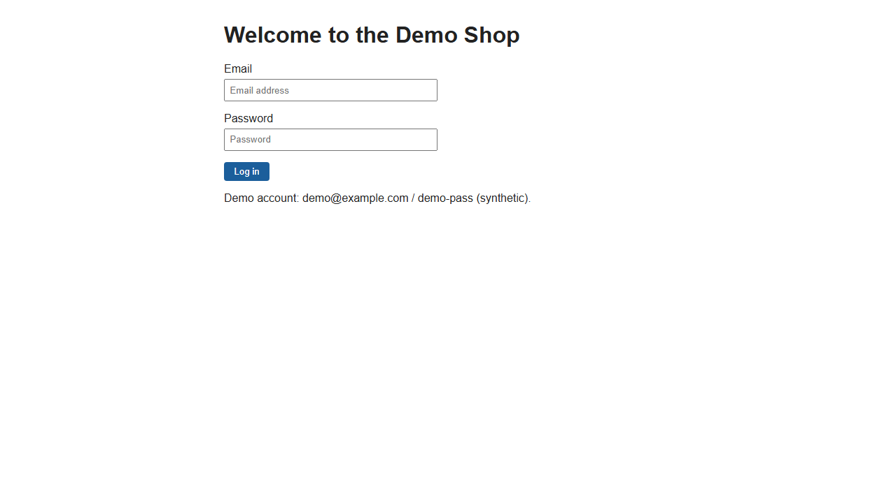

# AITAF test run report

## Summary

Tests: 5 (1 passed, 4 failed, 0 error, 0 skipped)

Run edb5bb7ee74046b6916fc94a425108ae on playwright headless, python 3.12.10, Windows 11, workers 1, timeout 10000 ms, retries 0, healing on; generated 2026-11-15 23:31 UTC.

Provider: mock

## Metrics

| Metric | Value | Basis |
|---|---|---|
| Pass rate | 20.0% | passed tests over executed tests (skipped tests excluded) |
| Requirement coverage | 90.0% | requirements with at least one approved test case over all requirements |
| Script executability | 9.3% | scripts whose test ran to a pass or a fail (no error) over scripts generated |
| Healing success rate | 100.0% | steps with a proposed locator over steps that asked for healing |
| Classification accuracy | n/a | failures whose category equals the supplied label over labelled failures |
| Generation latency (median) | 635 ms | analyze and generate steps of the three generation components, LLM time included |
| LLM call latency (median) | 2 ms | gateway calls to the provider (mock or live, see the provider label) |
| Non-LLM latency (p95) | n/a | report rendering samples, nearest-rank 95th percentile |
| API cost | $0.0000 | sum of token costs of the runs involved (zero for the mock provider) |
| API cost per run | $0.0000 | API cost divided by the 2 run(s) involved |

## Results

| Test case | Title | Requirement | Status | Duration | Attempts | Healed | Failure category |
|---|---|---|---|---|---|---|---|
| TC-019BAFBA-01 | Verify that a system can allow a registered customer to log in with an email address and a password | REQ-019BAFBA | PASSED | 241 ms | 2 | yes | - |
| TC-9881818E-02 | Reject invalid input when a system tries to show the message "Invalid email or password" and keep the product list closed when the credentials are wrong | REQ-9881818E | FAILED | 0 ms | 1 | no | unknown |
| TC-019BAFBA-03 | Check boundary values when a system tries to allow a registered customer to log in with an email address and a password | REQ-019BAFBA | FAILED | 31 ms | 1 | no | environment |
| TC-9881818E-01 | Verify that a system can show the message "Invalid email or password" and keep the product list closed when the credentials are wrong | REQ-9881818E | FAILED | 8 ms | 1 | no | timing_flaky |
| TC-019BAFBA-02 | Reject invalid input when a system tries to allow a registered customer to log in with an email address and a password | REQ-019BAFBA | FAILED | 80 ms | 2 | no | assertion_defect |

## Failure analysis

### TC-9881818E-02: unknown

Confidence 0.40 (llm) [AI-generated by mock-1, prompt fa-v1]; cluster CL-0df85e60.

- Cause: The failure (RuntimeError) matches no known pattern.
- Next step: Inspect the screenshot and the log, then classify it by hand.
- Evidence: log:eb20c4e4adfc4ffb8619f4131925b9a6, screenshot:tests_test_odd.py_test_odd.a1.png, dom:tests_test_odd.py_test_odd.a1.html


```text
page = <Page url='about:blank'>, base_url = 'http://127.0.0.1:8765'

    def test_odd(page, base_url):
>       raise RuntimeError('unexpected state')
E       RuntimeError: unexpected state

tests\test_odd.py:2: RuntimeError
```

[page snapshot](evidence/tests_test_odd.py_test_odd.a1.html) | [log](logs/eb20c4e4adfc4ffb8619f4131925b9a6.txt)

### TC-019BAFBA-03: environment

Confidence 0.85 (rules); cluster CL-bf03edc1.

- Cause: The environment or infrastructure failed ('net::ERR_UNSAFE_PORT'), not the logic under test.
- Next step: Check that the system under test, the network and the browser are running and reachable, then rerun.
- Evidence: log:709100021ebd4a7ca3abc21e781a491d, screenshot:tests_test_shop_down.py_test_shop_down.a1.png, dom:tests_test_shop_down.py_test_shop_down.a1.html


```text
.utils.zones.Zone object at 0x0000011B69B1BDA0>
func = <function ChannelOwner._wrap_api_call.<locals>.finish.<locals>.<lambda> at 0x0000011B69B25F80>

    async def run_async(self, func: Callable[[], Awaitable[R]]) -> R:
        # Python: run() of an async function. The coroutine runs when it is awaited,
        # so the zone must be current while it is awaited, not while it is created.
        token = [SECRET]
        try:
>           return await func()
                   ^^^^^^^^^^^^
E           playwright._impl._errors.Error: Page.goto: net::ERR_UNSAFE_PORT at http://127.0.0.1:1/
E           Call log:
E             - navigating to "http://127.0.0.1:1/", waiting until "load"

..\..\..\..\..\repos\UoP_Capston_Project_dilip\.venv\Lib\site-packages\playwright\_impl\utils\zones.py:58: Error
```

[page snapshot](evidence/tests_test_shop_down.py_test_shop_down.a1.html) | [log](logs/709100021ebd4a7ca3abc21e781a491d.txt)

### TC-9881818E-01: timing_flaky

Confidence 0.60 (rules); cluster CL-5a17fff7.

- Cause: An operation timed out: the page or system may be slow, or the test does not wait for the right condition.
- Next step: Rerun to see whether it recurs, wait for an explicit condition instead of a fixed delay, or raise the timeout.
- Evidence: log:615dbf36bd45429ebb20fa8052335bae, screenshot:tests_test_too_slow.py_test_too_slow.a1.png, dom:tests_test_too_slow.py_test_too_slow.a1.html



```text
_impl.utils.zones.Zone object at 0x0000011B699F9FA0>
func = <function ChannelOwner._wrap_api_call.<locals>.finish.<locals>.<lambda> at 0x0000011B699F6980>

    async def run_async(self, func: Callable[[], Awaitable[R]]) -> R:
        # Python: run() of an async function. The coroutine runs when it is awaited,
        # so the zone must be current while it is awaited, not while it is created.
        token = [SECRET]
        try:
>           return await func()
                   ^^^^^^^^^^^^
E           playwright._impl._errors.TimeoutError: Page.goto: Timeout 1ms exceeded.
E           Call log:
E             - navigating to "http://127.0.0.1:8765/", waiting until "load"

..\..\..\..\..\repos\UoP_Capston_Project_dilip\.venv\Lib\site-packages\playwright\_impl\utils\zones.py:58: TimeoutError
```

[page snapshot](evidence/tests_test_too_slow.py_test_too_slow.a1.html) | [log](logs/615dbf36bd45429ebb20fa8052335bae.txt)

### TC-019BAFBA-02: assertion_defect

Confidence 0.90 (rules); cluster CL-b1ec8cab.

- Cause: The application behaved differently from what the test expects: an assertion failed.
- Next step: Reproduce the step by hand; if the behaviour is wrong report a defect, otherwise update the expected value in the test.
- Evidence: log:29ec16a6d85f476887becda480826bd7, screenshot:tests_test_wrong_text.py_test_wrong_text.a2.png, dom:tests_test_wrong_text.py_test_wrong_text.a2.html


```text
healed shop.login_submit -> id=signin-btn (confidence 0.92, proposed, needs approval)
page = <Page url='http://127.0.0.1:8765/'>, base_url = 'http://127.0.0.1:8765'

    def test_wrong_text(page, base_url):
        s = ShopPage(page, base_url)
        s.open('/')
>       s.assert_text('login_submit', 'Sign in')

tests\test_wrong_text.py:7: 
_ _ _ _ _ _ _ _ _ _ _ _ _ _ _ _ _ _ _ _ _ _ _ _ _ _ _ _ _ _ _ _ _ _ _ _ _ _ _ _

self = <pages.shop_page.ShopPage object at 0x000001C9B4D6E030>
name = 'login_submit', expected = 'Sign in'

    def assert_text(self, name, expected):
>       assert expected in self._find(name).inner_text()
               ^^^^^^^^^^^^^^^^^^^^^^^^^^^^^^^^^^^^^^^^^
E       AssertionError

pages\shop_page.py:47: AssertionError
```

[page snapshot](evidence/tests_test_wrong_text.py_test_wrong_text.a2.html) | [log](logs/29ec16a6d85f476887becda480826bd7.txt)

## Self-healing

| Step | Method | Outcome | Confidence | Approved |
|---|---|---|---|---|
| tests/test_journey.py::test_journey#shop.login_submit | fallback | no_candidate | 0.00 | no |
| tests/test_journey.py::test_journey#shop.login_submit | similarity | proposed | 0.92 | no |

## Traceability

| Requirement | Test case | Script | Status | Failure category |
|---|---|---|---|---|
| REQ-019BAFBA | TC-019BAFBA-01 | tests/test_tc_019bafba_01.py | PASSED | - |
| REQ-9881818E | TC-9881818E-02 | tests/test_tc_9881818e_02.py | FAILED | unknown |
| REQ-019BAFBA | TC-019BAFBA-03 | tests/test_tc_019bafba_03.py | FAILED | environment |
| REQ-9881818E | TC-9881818E-01 | tests/test_tc_9881818e_01.py | FAILED | timing_flaky |
| REQ-019BAFBA | TC-019BAFBA-02 | tests/test_tc_019bafba_02.py | FAILED | assertion_defect |

## Notes and limits

- Figures come from the stored data of run edb5bb7ee74046b6916fc94a425108ae and source run 9cccd0b2b7304c75b3c7e93b4adfc06c.
- A metric shown as n/a could not be computed from the stored data.
- Some or all AI output comes from the deterministic mock provider, not a live model.
- Explanations marked AI-generated come from a model: review them before use.
